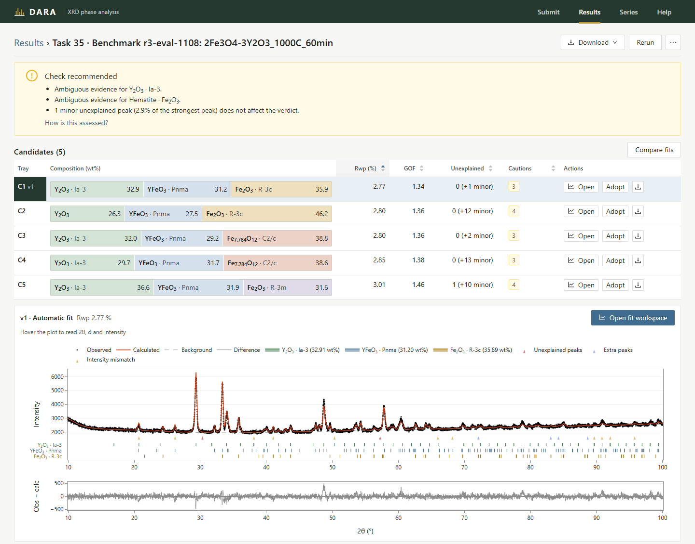
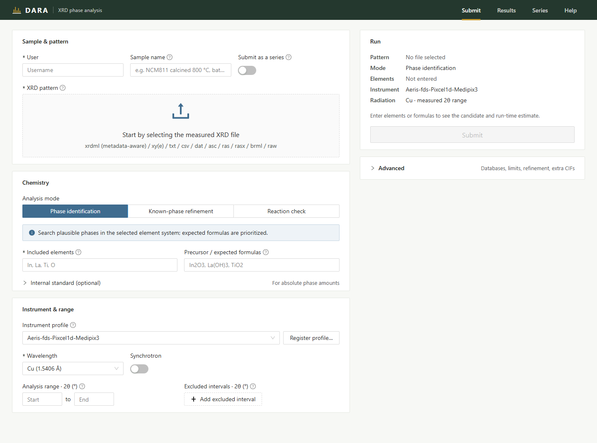
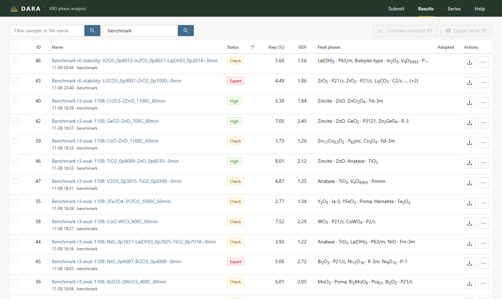
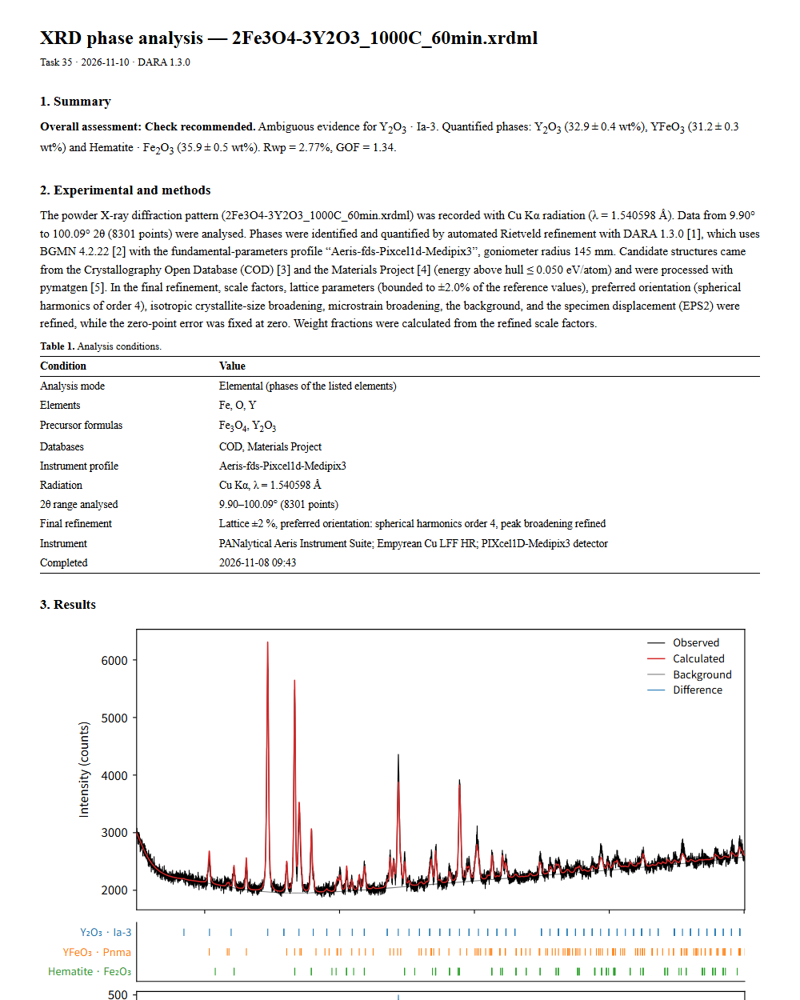

[English](README.md) | **한국어**

# Data-driven Automated Rietveld Analysis (DARA)

[](LICENSE)
[](https://doi.org/10.1021/acs.chemmater.5c02820)

이 프로그램은 [CederGroupHub/dara](https://github.com/CederGroupHub/dara)를 Windows에서 쓰기 편하게 고친 데스크톱 버전입니다. 분말 XRD 측정 파일과 시료에 들어 있을 원소(또는 상)를 넣으면 어떤 상이 있는지 찾고, BGMN으로 Rietveld 정밀화를 해서 상별 함량(wt%), 격자상수, 결정 크기를 계산합니다. 결과를 얼마나 믿을 수 있는지도 함께 판정합니다.

설치는 `START.cmd`를 한 번 실행하면 끝나고, 분석은 내 PC에서 돌아가는 DARA를 웹 브라우저로 열어서 합니다. 결과를 꼼꼼히 검토할 수 있는 화면도 새로 넣었습니다.



## 시작

1. 이 저장소를 내려받아(**Code → Download ZIP**) OneDrive 밖의 짧은 경로에 푸세요. 예: `C:\DARA`
2. **`START.cmd`** 를 더블클릭하세요.
3. 브라우저에 http://localhost:8898 이 열립니다.

Python을 미리 설치할 필요는 없습니다. 첫 실행 때는 DARA 폴더 안에 최대 약 1 GB를 내려받으며 5~15분이 걸립니다. 그 뒤로는 1초 안팎이면 켜지고 인터넷 없이도 동작합니다. 다만 구조 데이터베이스를 검색할 때는 인터넷이 필요합니다.

| | |
| --- | --- |
| 요구 사항 | Windows 10 또는 11(64비트), 여유 공간 약 3 GB |
| Materials Project 키 | 선택 사항이며 첫 실행 때 입력 창이 뜹니다. 키가 없으면 COD(Crystallography Open Database)만 사용합니다. |
| 업데이트 | START가 실행될 때 GitHub를 확인해 바뀐 파일만 받습니다. `UPDATE.cmd`는 DARA를 켜지 않고 업데이트만 합니다. Git은 필요하지 않습니다. |
| 종료 | 마지막 DARA 창을 닫으면 약 20초 뒤 서버가 꺼집니다. 분석이 진행 중이면 끝날 때까지 켜져 있습니다. |

실행 옵션, 종료 코드, 복구 방법은 [docs/launcher.md](docs/launcher.md)에서 볼 수 있습니다(영문).

## 1. 패턴 제출



측정 파일을 끌어다 놓고 시료가 무엇인지 알려 주세요.

- **파일 형식**: `.xrdml`(파장과 장비를 파일에서 읽습니다), `.xy`, `.xye`, `.txt`, `.csv`, `.dat`, `.asc`, `.scn`, `.ras`, `.rasx`, `.brml`, `.raw`
- **원소와 화학식**: 파일 이름에 들어 있으면 자동으로 채워집니다(`Li2CO3-ZrO2_900C.xrdml`).
- **Run 패널**: 제출하기 전에 시도할 참조 구조 수와 예상 시간을 표시합니다.

분석 모드는 이미 알고 있는 정보에 맞춰 고르면 됩니다.

| 모드 | 쓰는 경우 | 입력 |
| --- | --- | --- |
| **Phase identification** | 어떤 상이 생겼는지 모를 때 | 시료에 든 원소 |
| **Known-phase refinement** | 상은 알고 함량이 궁금할 때. 합성 수율, 잔류 원료, 배치 검사, 소성 시리즈 | 상의 화학식 |
| **Reaction check** | 원료를 소성했고 어떤 생성물이 나왔는지 볼 때 | 원료, 온도, 분위기 |

Known-phase refinement에서는 적어 넣은 상을 함께 정밀화합니다. 화학식마다 구조는 하나만 씁니다. 각 상은 설명되지 않은 피크 가운데 유의미하거나 작은(minor) 피크를 설명할 때만 피팅에 남습니다. 5 wt% 미만인 상은 그 상을 빼고 다시 피팅해 확인하고, 검색에서 선택되지 않은 상은 추가해 시험 피팅을 해 봅니다. 설명하는 피크가 없으면 말없이 빼지 않고 "검출 안 됨"으로 보고합니다. COD에 구조가 없는 화학식은 그 실행에 한해 Materials Project에서 구조를 가져옵니다. 끝난 결과의 구조를 다른 파일에 그대로 적용하는 기능도 있어서(**⋯ → Use these phases for other files…**) 시리즈 전체를 같은 참조 구조로 정량할 수 있습니다.

**장비 프로파일.** 사용하는 회절계에 맞는 프로파일을 고르세요. 맞는 것이 없으면 **Register profile… → Instrument setup**에서 사양서 값(고니오미터 반경, 슬릿, 솔러 각도, 검출기)을 입력합니다. 그러면 DARA가 몇 분 안에 프로파일을 계산해 줍니다. 다만 이 프로파일은 교정이 아니므로 결정 크기나 변형률을 믿기 전에 표준시료(Si, LaB₆)로 확인해야 합니다.

**시리즈.** **Submit as a series**를 켜면 패턴 2~50개를 같은 설정으로 한꺼번에 보낼 수 있습니다. Series 화면에서는 파일 이름의 변수(온도, 시간)에 따른 상 분율, 격자상수, 피팅 품질을 그래프로 확인합니다.

## 2. 결과 찾기



목록에는 분석마다 최적 Rwp, GOF, 최종 상, 판정이 표시됩니다. 시료·파일 이름이나 사용자로 필터링할 수 있습니다. 여러 줄을 골라 패턴을 겹쳐 보거나 표 하나로 내보낼 수도 있습니다.

## 3. 결과 확인

결과 화면은 판정, 후보 피팅, 패턴 순으로 구성됩니다.

| 판정 | 뜻 | 할 일 |
| --- | --- | --- |
| **High** | 모든 상이 모든 기준을 통과했습니다. | 그대로 사용하면 됩니다. |
| **Check** | 쓸 수는 있지만 한두 군데 확인할 곳이 있습니다. 모호한 상, 설명 안 된 피크 2~4개, 거의 같은 구조의 중복 등 | 적힌 이유를 읽어 보세요. |
| **Expert** | 그대로 쓰면 안 됩니다. 주요 상의 근거가 약함, 설명 안 된 피크가 많음, 정밀화 실패, Rwp 25 % 초과 등 | 그 계를 아는 사람에게 검토를 맡기세요. |

상마다 별도의 판정(Confident, Ambiguous, Weak evidence)과 이유가 붙습니다. 판정 기준은 [docs/user-guide/results-confidence.md](docs/user-guide/results-confidence.md)에서 확인할 수 있습니다(영문).

- **후보(Candidates)**: 비슷하게 잘 맞는 상 조합을 여러 개 남겨 둡니다(C1, C2, …). 하나를 누르면 화면 전체가 그 피팅으로 바뀝니다. **Compare fits**를 쓰면 두 개를 나란히 볼 수 있습니다.
- **설명 안 된 피크**: 패턴 위에 표시되며 significant, minor, instrument, noise로 등급이 매겨집니다.
- **Fit workspace**: 상을 더하거나 빼거나 바꿔서 다시 정밀화합니다. 시도할 때마다 버전(v2, v3, …)으로 저장됩니다.
- **Adopt**: 받아들일 피팅을 채택합니다. 보고서와 내보내기에는 채택한 피팅이 쓰입니다.

## 4. 결과 내보내기



**Download → Report (PDF + Word)** 를 누르면 논문 형식의 영문 보고서를 PDF와 편집 가능한 `.docx`로 받을 수 있습니다. 그 밖에 PNG(600 dpi)·SVG 그림, CSV 표, Profex/BGMN·TOPAS·GSAS-II·HighScore용 프로젝트 파일도 제공합니다.

## 더 보기

- 한글 사용설명서: [manual-ko.pdf](manual-ko.pdf)
- 판정 기준: [docs/user-guide/results-confidence.md](docs/user-guide/results-confidence.md)(영문)
- START.cmd 옵션과 복구: [docs/launcher.md](docs/launcher.md)(영문)
- 정확도 벤치마크와 개발용 스크립트: [scripts/README.md](scripts/README.md)(영문)
- 화면 개발: [src/dara/server/ui/README.md](src/dara/server/ui/README.md)(영문)
- 다른 운영체제: Python 3.12 환경에서 `pip install -e .` 후 `dara server`. 테스트는 Windows에서만 진행했습니다.

## 출처

DARA는 Ceder 그룹의 Yuxing Fei, Matthew J. McDermott와 동료들이 만들었습니다([CederGroupHub/dara](https://github.com/CederGroupHub/dara), MIT 라이선스). 정밀화 계산에는 [BGMN](http://www.bgmn.de/)을 사용합니다. 연구에 DARA를 사용했다면 아래 논문을 인용해 주시기 바랍니다.

```bibtex
@article{doi:10.1021/acs.chemmater.5c02820,
  author  = {Fei, Yuxing and McDermott, Matthew J. and Rom, Christopher L. and Wang, Shilong and Ceder, Gerbrand},
  title   = {Dara: Automated Multiple-Hypothesis Phase Identification and Refinement from Powder X-ray Diffraction},
  journal = {Chemistry of Materials},
  volume  = {38},
  number  = {3},
  pages   = {1364-1376},
  year    = {2026},
  doi     = {10.1021/acs.chemmater.5c02820}
}
```
