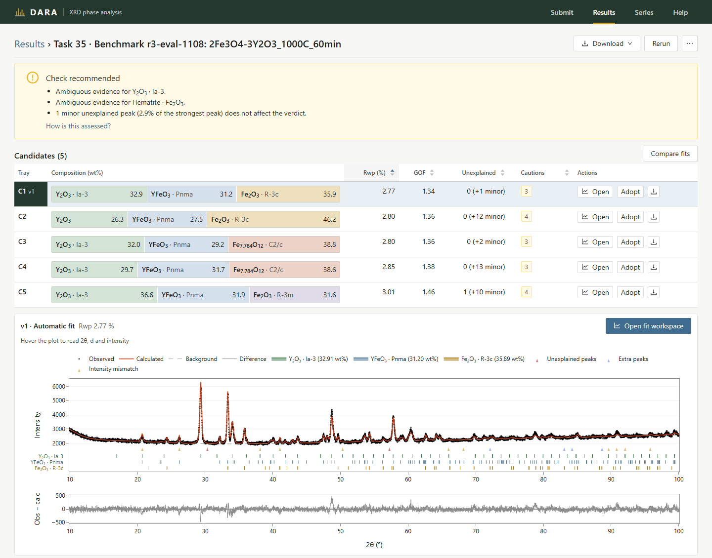
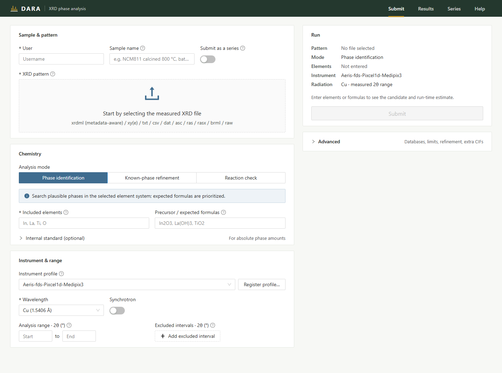
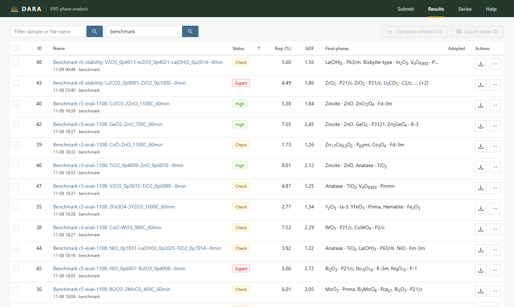
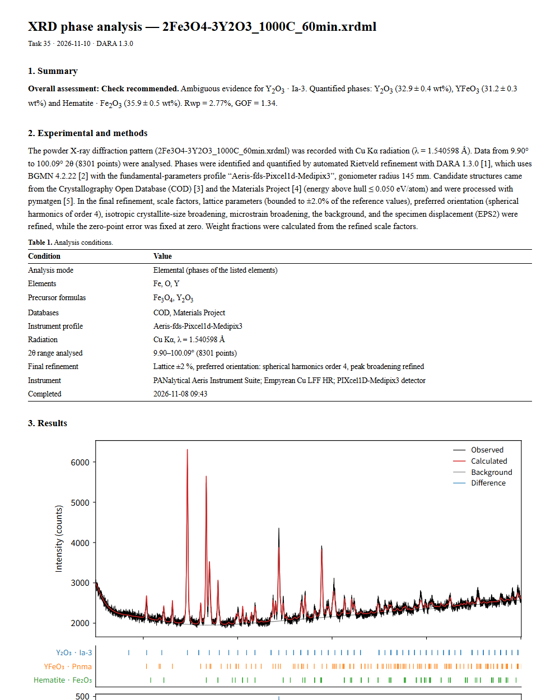

**English** | [한국어](README.ko.md)

# Data-driven Automated Rietveld Analysis (DARA)

[](LICENSE)
[](https://doi.org/10.1021/acs.chemmater.5c02820)

DARA finds the phases in a powder XRD pattern and refines them with BGMN (Rietveld), in a browser
on your own PC. You give it a measured pattern and the elements or phases you expect. It returns
the phases, their weight fractions, lattice parameters and crystallite sizes, with a verdict on how
far each result can be trusted.

This is a Windows desktop edition of [CederGroupHub/dara](https://github.com/CederGroupHub/dara).
It adds a one-click installer and a web interface built for checking results, not only producing
them.



## Start

1. Download this repository (**Code → Download ZIP**) and unpack it to a short path outside
   OneDrive, for example `C:\DARA`.
2. Double-click **`START.cmd`**.
3. The browser opens http://localhost:8898.

No Python installation is needed. The first launch downloads up to about 1 GB into the DARA folder
and takes 5 to 15 minutes. Later launches take about a second and work offline. Searching the
structure databases still needs the internet.

| | |
| --- | --- |
| Requirements | Windows 10 or 11 (64-bit), about 3 GB of free disk space |
| Materials Project key | Optional. A dialog asks for it on first launch. Without a key DARA uses the Crystallography Open Database (COD) only. |
| Update | START checks GitHub at launch and downloads only the files that changed. `UPDATE.cmd` does the same without starting DARA. Git is not needed. |
| Stop | Close the last DARA window. The server stops about 20 seconds later. A running analysis keeps it alive. |

Switches, exit codes and recovery steps are in [docs/launcher.md](docs/launcher.md).

## 1. Submit a pattern



Drop the measured file, then say what the sample is.

- **File formats**: `.xrdml` (wavelength and instrument are read from the file), `.xy`, `.xye`,
  `.txt`, `.csv`, `.dat`, `.asc`, `.scn`, `.ras`, `.rasx`, `.brml`, `.raw`.
- **Elements and formulas** are filled from the file name when it contains them
  (`Li2CO3-ZrO2_900C.xrdml`).
- **The Run panel** shows how many reference structures will be tried and how long that should
  take, before you submit.

Choose the analysis mode by what you already know:

| Mode | Use it when | You enter |
| --- | --- | --- |
| **Phase identification** | You do not know which phases formed. | The elements in the sample |
| **Known-phase refinement** | You know the phases and want their amounts: synthesis yield, residual precursor, batch checks, a firing series. | The phase formulas |
| **Reaction check** | You fired precursors and want to see which products appeared. | Precursors, temperature, atmosphere |

In Known-phase refinement the phases you list are refined together, one structure per formula. A phase
stays in the fit only if it explains significant or minor unexplained peaks: a minor phase (below 5 wt%)
is refit without it, and a listed phase the search did not pick is tried by adding it. Otherwise it is
reported as not detected, never dropped silently. A formula with no COD
structure is taken from Materials Project for that run. A finished result's exact structures can be
applied to other files (**⋯ → Use these phases for other files…**), so a series is quantified with
the same references throughout.

**Instrument profile.** Pick the profile that matches your diffractometer. If none does, use
**Register profile… → Instrument setup** and enter the datasheet values: goniometer radius, slits,
Soller angles and detector. DARA computes the profile from them in a few minutes. A profile is not
a calibration: check it against a standard (Si, LaB₆) before you trust sizes or strain. **Calibrate with a
standard…** fits the detector width (DetW) of such a profile to a measured Si, LaB₆ or Al₂O₃
pattern and saves the result as a new profile.

**Series.** Turn on **Submit as a series** to send 2 to 50 patterns with the same settings. The
Series page plots phase fractions, lattice parameters and fit quality against the variable in the
file names (temperature, time).

## 2. Find the result



The list shows the best Rwp, GOF, final phases and the verdict of every analysis. Filter by sample
or file name, or by user. Select several rows to overlay their patterns or export one table.

## 3. Check the result

The result page puts the verdict first, then the candidate fits, then the pattern.

| Verdict | Meaning | What to do |
| --- | --- | --- |
| **High** | Every phase passes every check. | Use the result. |
| **Check** | Usable, with one or two things to look at: an ambiguous phase, two to four unexplained peaks, a near-duplicate structure. | Read the listed reasons. |
| **Expert** | Not to be used as it is: weak evidence for a main phase, many unexplained peaks, a failed refinement, Rwp above 25 %. | Have someone who knows the system review it. |

Each phase also gets its own verdict (Confident, Ambiguous, Weak evidence) with the reasons. The
rules are in [docs/user-guide/results-confidence.md](docs/user-guide/results-confidence.md).

- **Candidates**: DARA keeps several phase combinations that fit about equally well (C1, C2, …).
  Click one and the whole page shows that fit. **Compare fits** puts two side by side.
- **Unexplained peaks** are marked on the pattern and graded significant, minor, instrument or
  noise.
- **Fit workspace**: add, remove or swap a phase and refine again. Each attempt is saved as a
  version (v2, v3, …).
- **Adopt** the fit you accept. Reports and exports use the adopted fit.

## 4. Take the result out



**Download → Report (PDF + Word)** gives a paper-style report in English as a PDF and an editable
`.docx`. Other downloads: PNG (600 dpi) and SVG figures, CSV tables, and project files for
Profex/BGMN, TOPAS, GSAS-II and HighScore.

## More

- Korean manual: [manual-ko.pdf](manual-ko.pdf)
- How the verdicts are decided: [docs/user-guide/results-confidence.md](docs/user-guide/results-confidence.md)
- START.cmd switches and recovery: [docs/launcher.md](docs/launcher.md)
- Accuracy benchmark and developer scripts: [scripts/README.md](scripts/README.md)
- Front-end development: [src/dara/server/ui/README.md](src/dara/server/ui/README.md)
- Other platforms: `pip install -e .` in your own Python 3.12 environment, then `dara server`.
  Only Windows is tested.

## Credits

DARA was created by Yuxing Fei, Matthew J. McDermott and co-workers in the Ceder group
([CederGroupHub/dara](https://github.com/CederGroupHub/dara), MIT licence). Refinement is done by
[BGMN](http://www.bgmn.de/). If you use DARA in your research, please cite:

```bibtex
@article{doi:10.1021/acs.chemmater.5c02820,
  author  = {Fei, Yuxing and McDermott, Matthew J. and Rom, Christopher L. and Wang, Shilong and Ceder, Gerbrand},
  title   = {Dara: Automated Multiple-Hypothesis Phase Identification and Refinement from Powder X-ray Diffraction},
  journal = {Chemistry of Materials},
  volume  = {38},
  number  = {3},
  pages   = {1364-1376},
  year    = {2026},
  doi     = {10.1021/acs.chemmater.5c02820}
}
```
