# DARA 한글 사용 설명서

분말 XRD 상 동정과 Rietveld 정밀화를 자동으로 처리하는 웹 프로그램

> 기준 버전: 저장소 main 브랜치(2026-11-11). 저장소 [youngboong/DARA-Desktop](https://github.com/youngboong/DARA-Desktop).
> 화면 문구는 앱의 영어 표기를 그대로 적습니다. 예: Submit, Results, High confidence.

| 장 | 내용 |
| --- | --- |
| 01 시작하기 | DARA 소개, 준비물, 내려받기, START.cmd 첫 실행, MP 키 입력 창, 종료 |
| 02 분석 제출 | 필수 순서(패턴 → 모드 → 원소·화학식 → 장비·파장 → Submit)와 선택 설정 |
| 03 결과 확인 | 결과 목록, 신뢰도 배너, 상별 판정, 미설명 피크, 후보와 채택 |
| 04 보고서와 내보내기 | Download 메뉴, 보고서(PDF + Word, HTML), 그림, CSV, 외부 프로그램용 파일 |
| 05 결과 해석 시 주의 | 상대 wt%, 불확도, 계산 구조, 질량 균형 해석 |
| 06 결과 다듬기 | 피팅 창과 그래프 조작, 빠른 재정밀화와 버전, 상 추가·제거, 구조 정밀화, 두 피팅 비교 |
| 07 특수 기능 | Known-phase refinement 세부 규칙, 상 구성 재사용, 시리즈 분석 |
| 08 문제 해결 | 실패 작업 재시도, 자주 겪는 상황과 대처 |
| 09 부록 | MP 키 받기·바꾸기, 장비 프로파일 등록, CIF 구하기, 업데이트, START 스위치, 폴더 |

> 그림 1을 뺀 화면 그림은 2026-11-11 화면을 캡처한 것입니다. 빨간 번호와 상자는 설명용으로 덧붙인 표시이고 그림 아래 같은 번호의 항목이 그 설명입니다. 그림 속 시료 이름과 수치는 조작을 설명하려고 넣은 값이므로 검증된 분석 결과로 인용하면 안 됩니다.

## 01 시작하기

DARA는 분말 X선 회절(XRD) 패턴에서 결정상 후보를 자동으로 찾고 BGMN 엔진으로 Rietveld 정밀화까지 마치는 웹 프로그램입니다. Ceder 그룹이 공개한 원본(Chemistry of Materials, 2026)에 설치, 입력 형식, 결과 검토, 보고서 기능을 더한 맞춤판입니다. 자동 결과는 판정 근거와 함께 나오므로 어디를 검토할지 좁힐 수 있습니다. 결과를 확정하는 일은 사용자 몫입니다.

- 패턴 한 개나 여러 개(시리즈)를 올리면 상 동정과 정량이 한 번에 끝납니다.
- 결과마다 신뢰도 배너(High confidence / Check recommended / Expert review recommended)와 상별 판정이 붙습니다.
- 설명되지 않은 피크는 분류해 두고 미량상 후보도 제시합니다.
- 완료된 작업에서 상을 더하거나 빼면 바로 다시 정밀화하고 결과는 버전으로 쌓입니다.
- 논문형 영문 보고서(PDF, Word, HTML), 그림(PNG/SVG), CSV 표, Profex·TOPAS·GSAS-II·HighScore용 파일을 내보냅니다.

상단 메뉴는 Submit, Results, Series, Help(Tutorial, Documentation)이고 주소는 http://localhost:8898입니다.

### 준비물

| 구분 · 항목 | 내용 |
| --- | --- |
| 필수 · Windows PC | Windows 10/11 64비트에 여유 공간이 약 3 GB 있어야 합니다. 폴더는 OneDrive 동기화 폴더 밖의 짧은 경로(예: C:\DARA)에 두세요. |
| 필수 · 인터넷(첫 실행) | uv, Python 3.12, 패키지, BGMN을 내려받습니다(약 1 GB). 설치가 끝나면 오프라인에서도 돌아가지만 COD/MP 구조 검색에는 인터넷이 있어야 합니다. |
| 필수 · 측정 패턴 | .xrdml을 권장하며 지원 형식은 2장에서 다룹니다. |
| 필수 · 시료 정보 | 포함 원소, 전구체나 예상 화학식, 측정 파장. Reaction check를 쓰려면 열처리 온도와 분위기도 필요합니다. |
| 선택 · MP API 키 | Materials Project 계산 구조를 후보로 쓰려면 있어야 합니다. 키가 없어도 COD만으로 분석할 수 있습니다. 받는 방법은 9장을 보세요. |
| 선택 · 장비 프로파일 | 기본 목록에 실제 장비·광학계와 맞는 항목이 없을 때만 등록합니다(9장). |
| 선택 · 참조 CIF | DB에 없는 상이나 연구실에서 검증한 구조를 추가할 때 넣습니다. |

Python, Git, Anaconda를 미리 설치할 필요는 없습니다. 필요한 도구는 START.cmd가 DARA 폴더 안에 알아서 설치합니다.

### 내려받기

[https://github.com/youngboong/DARA-Desktop](https://github.com/youngboong/DARA-Desktop)에서 Code → Download ZIP을 선택해 받은 ZIP을 오른쪽 클릭하고 "모두 압축 풀기"를 실행하세요. 압축 파일 안에서 바로 실행하면 설치가 실패합니다. 한 폴더에 START.cmd, src, scripts, pyproject.toml이 보이면 준비가 끝났습니다.

### START.cmd 첫 실행

START.cmd를 더블클릭하세요. 첫 실행은 uv와 Python 3.12 설치(DARA 폴더의 tools\), 프로젝트 환경(.venv) 생성, BGMN 내려받기, MP 키 입력 창, 서버 시작 순서로 진행되며 5~15분이 걸리므로 도중에 창을 닫지 마세요. 서버가 준비되면 브라우저에 http://localhost:8898이 열립니다.

중간에 끊겨도 START.cmd를 다시 실행하면 멈춘 곳부터 이어 갑니다. 두 번째 실행부터는 설치 단계 없이 서버가 바로 뜹니다.

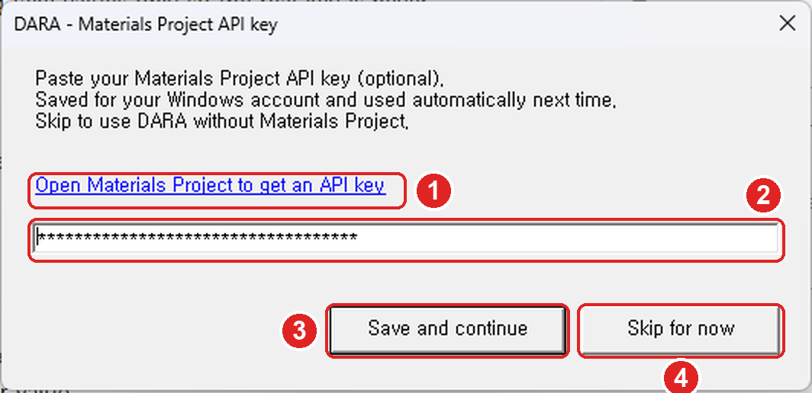{height=170}

(1) Open Materials Project to get an API key: 키가 없을 때 누르면 MP 사이트가 열립니다. 그다음은 9장 MP API 키 받기를 따르세요.
(2) 키 입력 칸: 복사한 키를 Ctrl+V로 붙여 넣습니다. 화면에는 점으로만 표시됩니다.
(3) Save and continue: 키를 저장하고 설치를 이어 갑니다. 칸이 비어 있으면 저장 대신 안내 문구가 뜹니다.
(4) Skip for now: 키 없이 넘어가며 이후 실행에서는 다시 묻지 않습니다.

- 저장한 키는 Windows 사용자 환경변수 MP_API_KEY에 남아 다음 실행부터 자동으로 쓰입니다.
- 키 상태는 Submit 화면 Advanced 카드의 MP 스위치 옆 태그에 표시됩니다. MP key valid는 정상, MP key rejected는 틀렸거나 폐기된 키, MP key not configured는 키 없음, MP key not verified는 인터넷 문제로 확인하지 못한 상태이고 Re-check를 누르면 다시 조회합니다.
- 키 없이 쓸 때는 Reference databases에서 MP를 끄고 COD로 분석하세요. 키를 나중에 넣거나 바꾸려면 9장을 참고하세요.

### 종료와 여러 창

- 마지막 DARA 브라우저 창을 닫으면 약 20초 뒤 서버가 스스로 꺼지는데 대기 중이거나 실행 중인 분석이 있으면 끝날 때까지 켜져 있습니다. 바로 끄려면 START 창에서 Ctrl+C를 누르세요.
- 서버가 떠 있을 때 START.cmd를 다시 실행하면 새 브라우저 창만 열리고 창 여러 개를 함께 써도 됩니다.
- START.cmd는 실행할 때마다 GitHub에서 새 버전을 확인합니다(자세한 내용은 9장 업데이트).

## 02 분석 제출

Submit 화면에서는 아래 다섯 단계만 채우면 분석을 시작할 수 있습니다. 나머지 항목은 기본값으로 두어도 됩니다.

1. XRD pattern에 측정 파일을 끌어 놓거나 눌러서 고릅니다.
2. Analysis mode를 정합니다.
3. Included elements와 화학식 칸을 채웁니다.
4. Instrument profile과 Wavelength를 확인합니다.
5. 오른쪽 Run 카드의 Submit을 누르고 확인 창에서 확정합니다.

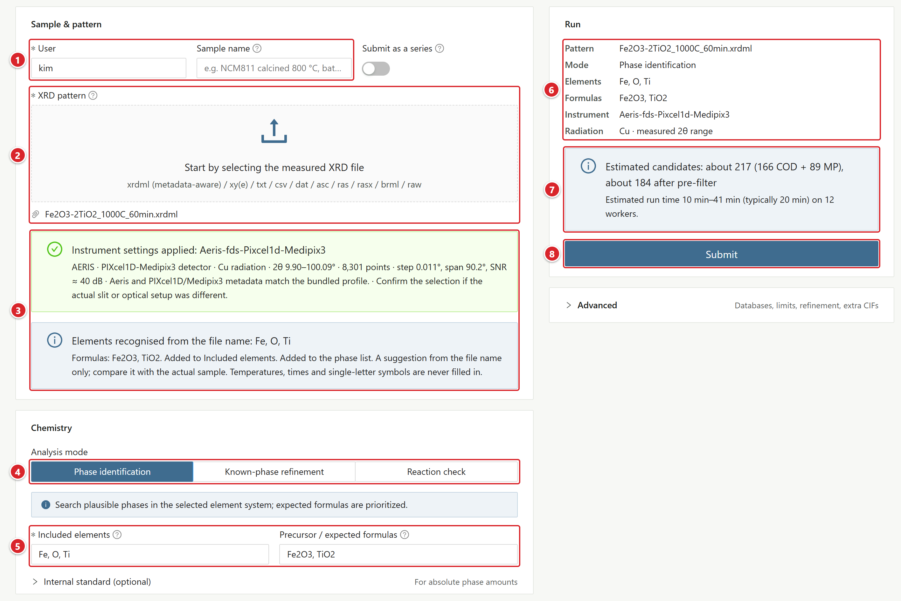{height=325}

(1) User / Sample name: 제출자를 구분하는 이름과 결과 목록에 보일 시료 이름(선택)입니다.
(2) XRD pattern: 측정 파일을 올리는 곳입니다. 올린 파일 이름이 아래에 표시됩니다.
(3) 파일에서 읽은 내용: XRDML 메타데이터로 고른 장비 설정(Instrument settings applied)과 파일 이름에서 읽은 원소·화학식(Elements recognised from the file name).
(4) Analysis mode: Phase identification, Known-phase refinement, Reaction check 중 하나를 선택합니다.
(5) Included elements / Precursor / expected formulas: 원소 기호와 예상 화학식을 넣습니다.
(6) Run 카드 요약: 패턴, 모드, 원소, 화학식, 장비, 파장과 2θ 범위.
(7) 예상 후보 수와 Estimated run time. 조건을 바꾸면 새로 계산됩니다.
(8) Submit: 누르고 확인 창에서 확정하면 작업이 만들어집니다.

### 1단계: 패턴 올리기

지원 형식은 .xrdml, .xy, .xye, .txt, .csv, .dat, .asc, .scn, .ras, .rasx, .brml, .raw(Bruker RAW v2만)입니다. 읽기에 실패하면 문제가 된 줄 번호가 표시됩니다.

- XRDML 파일은 메타데이터를 읽어 가장 가까운 Instrument profile과 Wavelength를 자동으로 고르는데 실제 슬릿·광학계와 다르면 직접 고치세요.
- 파일 이름에서 화학식을 읽어 원소와 화학식 칸을 채웁니다(예: BiFeO3_800C_60min.xrdml → Bi, Fe, O). 이미 적어 둔 값은 그대로 두고 온도와 시간은 채우지 않습니다. 제안된 값은 실제 시료와 맞춰 보고 쓰세요.
- Data quality pre-check (advisory)는 강도 정규화, S/N, 스텝 간격, 측정 범위를 점검하는 경고로 참고용이라 제출을 막지 않습니다.
- Sample name(선택)은 Results 목록에 파일 이름 대신 보이고 검색에도 쓰입니다.

### 2단계: Analysis mode 고르기

| 모드 | 쓰임과 입력 |
| --- | --- |
| Phase identification | 원소계 안에서 가능한 상을 찾으며 Included elements가 필수입니다(예: Bi, Fe, O). Precursor / expected formulas에 적은 상은 후보에 반드시 들어갑니다. |
| Known-phase refinement | 구성 상을 이미 알고 있을 때 씁니다. Phases to refine에 적은 상(서로 다른 화학식 최대 12개)을 함께 정밀화하고 각 상의 DB 구조는 DARA가 고릅니다. 적지 않은 불순물이나 생성물은 찾지 않습니다. 세부 규칙은 7장에서 설명합니다. |
| Reaction check | 전구체, Temperature (°C), Atmosphere로 생성물을 예측해 피팅합니다. 후보가 적어 가장 빠르고 MP 데이터를 씁니다. |

### 3단계: 원소와 화학식

- Included elements: 원소 기호를 쉼표로 구분해 넣습니다(예: Fe, Ti, O). Phase identification이 아니면 화학식에서 원소를 뽑아 쓰므로 비워 둘 수 있습니다.
- 잔류 전구체나 홀더 성분의 원소를 빠뜨리면 그 상은 처음부터 후보에 오르지 못합니다.
- Precursor / expected formulas(Known-phase refinement에서는 Phases to refine): 화학식을 쉼표로 구분해 넣습니다. 전구체 양까지 적으면 질량 균형 점검이 켜집니다(이 장 뒤쪽 전구체 양 입력).

### 4단계: 장비 프로파일과 파장

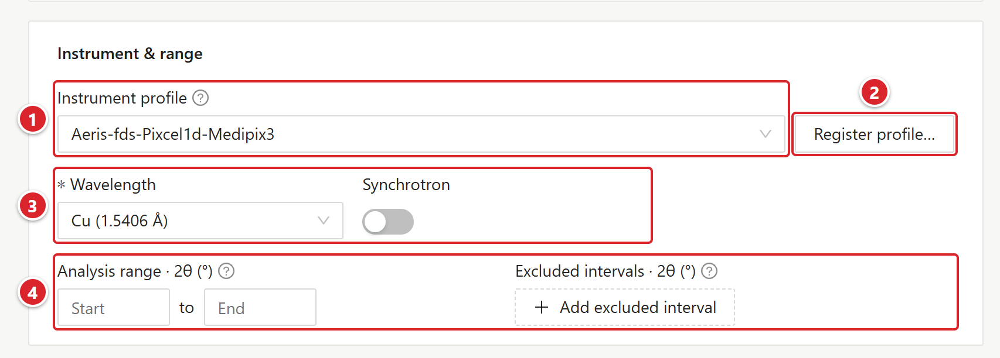{height=150}

(1) Instrument profile: 장비 조건을 고릅니다.
(2) Register profile…: 목록에 맞는 장비가 없을 때 새로 등록합니다(9장).
(3) Wavelength / Synchrotron: 광원과 파장을 지정합니다.
(4) Analysis range · 2θ (°) / Excluded intervals · 2θ (°): 분석 범위와 제외 구간.

- Instrument profile 목록에서 실제 장비, 검출기, 슬릿 조건에 맞는 항목을 고르세요. 맞는 항목이 없으면 Register profile…로 등록합니다(9장). 다만 등록과 교정은 별개라서 표준시료(Si, LaB6)를 피팅해 따로 검증해야 합니다.
- 실험실 광원이면 Wavelength에서 Cu, Co, Cr, Fe 등을 고르고 Synchrotron을 켜면 Wavelength (Å)에 값을 직접 입력합니다(예: 0.7293).
- XRDML의 파장과 고른 파장이 다르면 제출할 때 "The selected wavelength differs from the file" 창이 뜨는데 여기서 Submit anyway나 Go back and check를 선택하세요.

### 5단계: Submit

Run 카드에는 패턴, 모드, 원소, 장비, 파장과 2θ 범위 요약, 예상 후보 수와 Estimated run time이 표시됩니다. 예상값은 대략적인 값이라 조건을 바꿀 때마다 새로 계산됩니다. Submit을 누르고 확인 창에서 확정하세요.

같은 브라우저에서는 마지막으로 제출한 User 이름과 설정(분석 모드, DB, 시간 제한, 장비, 파장, Final refinement controls)이 다음 Submit 화면에 미리 채워집니다. 다만 패턴 파일, 원소·화학식, Sample name은 매번 새로 넣습니다. 기본값으로 되돌리려면 User 칸 아래 Reset to defaults를 누르세요.

## 02 분석 제출 · 선택 설정

아래 항목은 필요할 때만 바꾸세요. 기본값과 다른 항목이 있으면 Advanced 카드에 N changed 태그가 붙고 카드가 펼쳐진 채로 열립니다.

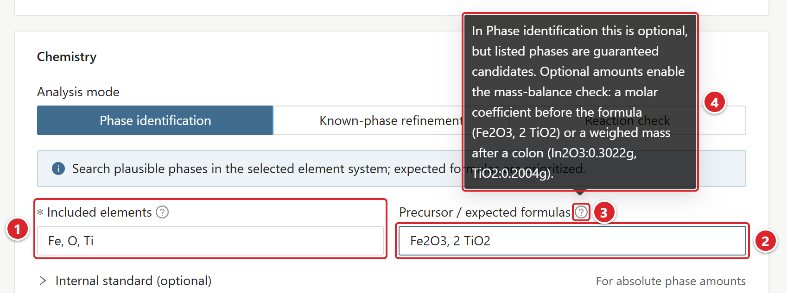{height=170}

(1) Included elements: 원소 기호를 넣습니다(예: Fe, Ti, O).
(2) Precursor / expected formulas: 전구체와 양. 예시는 Fe2O3 1몰과 TiO2 2몰입니다.
(3) 도움말 아이콘. 마우스를 올리면 입력 형식 안내가 나타납니다.
(4) 도움말 내용: 화학식 앞 몰 계수(Fe2O3, 2 TiO2) 또는 콜론 뒤 칭량 질량(In2O3:0.3022g, TiO2:0.2004g).

### 전구체 양 입력

Precursor / expected formulas에 양까지 적으면 결과에서 질량 균형을 점검하고(5장) 양을 적지 않으면 점검을 건너뜁니다.

- 몰 계수: Fe2O3, 2 TiO2 (계수가 없는 항목은 1)
- 칭량 질량: In2O3:0.3022g, TiO2:0.2004g (단위는 g, mg, mol, mmol. 생략하면 g)
- 양은 모든 항목에 적어야 하며 일부만 적으면 점검을 건너뜁니다. 한 항목에 계수와 질량을 함께 쓰면 오류가 납니다.
- 칸에 양이 없으면 파일 이름에서 읽어 옵니다(예: 2Fe3O4-3Y2O3_1000C_60min, In2O3_0p3022-TiO2_0p2004). 칸 입력이 우선하며 주의할 점은 5장에서 다룹니다.

### 내부 표준(절대 정량)

시료에 결정질 표준물질을 정해진 양만큼 섞어 측정했다면 Chemistry 카드의 Internal standard (optional)를 펼치세요.

- Standard formula: 섞은 표준물질의 화학식(예: Si. 목록에는 Si, Al2O3, ZnO, CeO2, CaF2, LaB6가 있습니다). 표준물질의 원소는 Included elements에 더해집니다.
- Added amount (wt% of the mixture): 혼합물 전체에서 표준물질이 차지하는 무게 비율(0~100 사이).
- 제출할 때 넣지 않았어도 결과 화면에서 나중에 넣을 수 있습니다(3장).

### Reference databases와 속도 조절

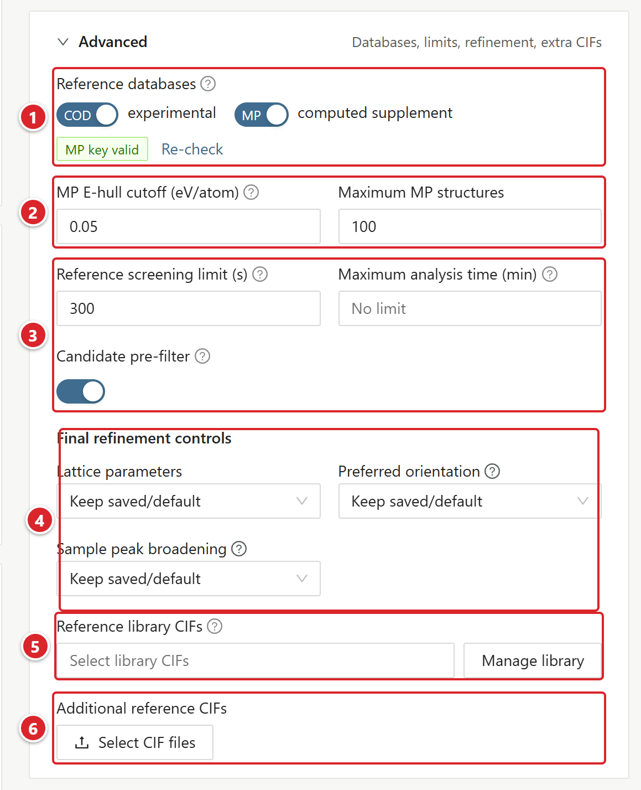{height=330}

(1) Reference databases: COD·MP 스위치와 MP 키 상태 태그(MP key valid), Re-check.
(2) MP E-hull cutoff (eV/atom) / Maximum MP structures: MP 후보를 얼마나 넓게 받을지 정합니다.
(3) Reference screening limit (s), Maximum analysis time (min), Candidate pre-filter: 속도 조절 항목.
(4) Final refinement controls: Lattice parameters, Preferred orientation, Sample peak broadening.
(5) Reference library CIFs: 서버에 저장해 둔 CIF를 고르고 Manage library로 관리합니다.
(6) Additional reference CIFs: 이번 작업에만 쓸 CIF를 올립니다(Select CIF files).

COD(experimental)에는 실험 구조가, MP(computed supplement)에는 보충용 계산 구조가 들어 있습니다. MP E-hull cutoff(기본 0.05 eV/atom)와 Maximum MP structures(기본 100)를 늘리면 후보가 늘어나는 만큼 계산 시간도 함께 늘어납니다.

<!-- widths: 140,347 -->
| 항목 | 동작 |
| --- | --- |
| Candidate pre-filter | 기본으로 켜져 있으며 참조 구조의 강한 피크가 측정 패턴에 없으면 그 구조를 미리 뺍니다. 업로드·라이브러리·전구체 상은 이 단계에서 빠지지 않습니다. |
| Reference screening limit (s) | 선별 단계에서 참조 하나에 BGMN이 쓸 수 있는 최대 시간입니다. 기본 300 s, 입력 범위 60~1200입니다. |
| Maximum analysis time (min) | 5~720분. 시간이 다 되면 그때까지 얻은 최선 결과를 미완료 표시와 함께 돌려주며 비워 두면 제한이 없습니다. |

### 2θ 범위와 최종 정밀화 조건

- Analysis range · 2θ (°)를 비워 두면 측정 범위 전체를 씁니다. Add excluded interval은 홀더나 장비 아티팩트가 확인된 위치에만 쓰세요. 범위나 제외 구간이 다른 작업끼리는 Rwp를 직접 비교하면 안 됩니다.
- Final refinement controls(Advanced 카드)는 처음에 Keep saved/default로 두고 결과에서 문제를 찾은 뒤 한 항목씩 바꿔 가며 비교하세요. 자유도를 늘려 내려간 Rwp는 그것만으로 상 동정을 입증하기에 부족합니다.

### 참조 CIF 넣기

Reference library CIFs는 서버에 저장해 두고 여러 작업에서 다시 쓰는 구조이고(Manage library → Add CIF to library) Additional reference CIFs(Select CIF files)는 이번 작업에만 쓰는 구조입니다. 같은 상의 CIF를 여러 개 넣으면 정량값이 쪼개지므로 상 하나에는 CIF 하나만 넣으세요. CIF를 구하는 방법은 9장을 보세요.

### 다시 실행(Rerun)

작업 페이지 제목 줄의 Rerun이나 Results 목록 행 끝 … 메뉴의 Rerun with these settings…를 누르면 원래 패턴과 조건이 채워진 Submit 화면이 열립니다. 바꿀 항목만 고쳐 제출하면 원본은 그대로 남고 새 작업이 생깁니다. 패턴을 바꾸려면 Replacement pattern (optional)에 새 파일을 올리면 됩니다. 원래 작업에 올린 CIF를 다시 쓸지는 Reuse N saved reference CIFs 스위치로 정합니다.

한 결과의 상 구성을 다른 파일에 그대로 적용하는 방법(Use these phases for other files…)과 여러 패턴을 한 번에 내는 시리즈 제출은 7장에서 설명합니다.

## 03 결과 확인

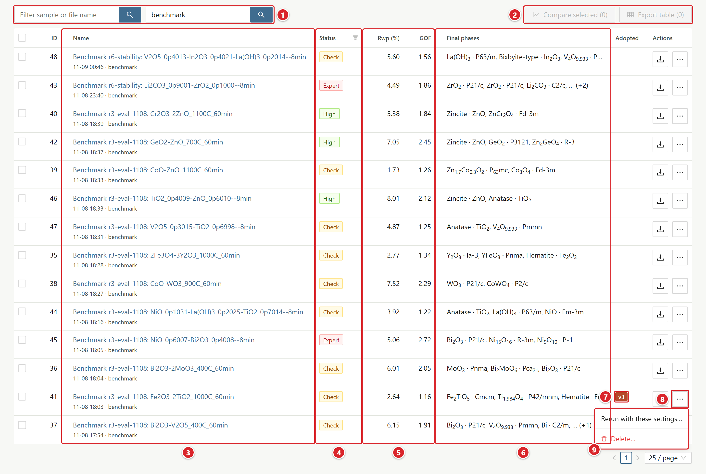{height=327}

(1) 검색 칸: Filter sample or file name, Filter username으로 시료·파일 이름이나 사용자를 거릅니다.
(2) Compare selected / Export table: 체크한 작업을 겹쳐 보거나 결과 표를 CSV로 저장합니다.
(3) Name: 시료 이름(없으면 파일 이름)과 그 아래 날짜·사용자. 맨 앞에는 ID 열이 있습니다.
(4) Status: 작업 상태 태그. 끝난 작업은 신뢰도 태그(High, Check, Expert)로 나오므로 무엇부터 검토할지 정할 수 있습니다. 머리글의 필터 아이콘으로 상태별로 거릅니다.
(5) Rwp (%) / GOF: 적합도. Rwp는 채택한 피팅의 값이고 채택이 없으면 자동 피팅의 값입니다.
(6) Final phases: 최종 정밀화된 상.
(7) Adopted: 채택한 결과 표시. v3은 버전 3, #2는 후보 2를 채택했다는 뜻입니다.
(8) 행 끝 버튼: 결과 ZIP 내려받기와 … 메뉴.
(9) … 메뉴: Rerun with these settings…, Delete…. 자동 조치가 있는 실패 작업이면 Retry with fix (…)도 들어갑니다.

| Status | 의미 |
| --- | --- |
| Queued / Running | 대기 중 / 분석 중. 작업 페이지에서 진행 단계를 볼 수 있고 Stop analysis로 멈출 수 있습니다 |
| High / Check / Expert | 완료. 태그는 신뢰도 등급이므로 작업 페이지의 신뢰도 배너부터 보세요 |
| No fit | 검색은 끝났는데 피팅이 나오지 않았습니다. 어떤 설정을 넓힐지 작업 페이지에서 확인하세요 |
| Failed | 실패. 태그에 마우스를 올리면 원인 요약이 뜹니다. 재시도 방법은 8장을 보세요 |
| Stopping / Cancelled | 중단 처리 중 / 중단 완료 |

### 작업 페이지 구성

작업 페이지는 위에서부터 이 순서로 놓입니다.

1. 제목 줄: Download 메뉴(4장), Rerun, … 메뉴(Use these phases for other files…, Use these phases for a series…, Delete…).
2. 신뢰도 배너.
3. Candidates 표와 그 아래 피팅 그래프. 표의 행을 누르면 그 후보의 피팅이 그래프에 그려지고 Open fit workspace를 누르면 피팅 창이 열립니다(6장).
4. Adopted fit & notes(채택과 메모), Versions 표(6장).
5. Phases 표: 상별 판정, wt%, 격자상수, 결정 크기. 내부 표준이 있으면 그 아래로 절대 정량 표가 이어집니다.
6. Cautions, 요약 표(Pattern file, Analysis mode, Run, Fit quality, Peak diagnostics), 접힌 Analysis settings(제출 조건).

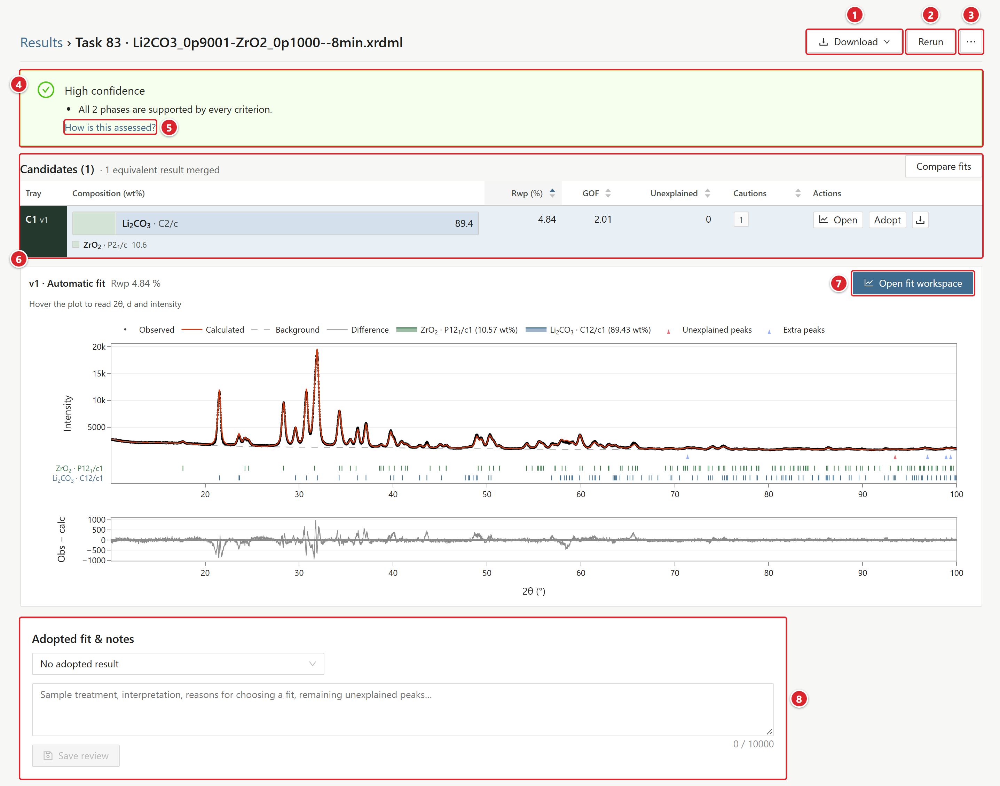{height=383}

(1) Download: 보고서, 그림, CSV, 외부 프로그램용 파일을 받는 메뉴(4장).
(2) Rerun: 원래 패턴과 조건이 채워진 Submit 화면을 엽니다.
(3) … 메뉴: Use these phases for other files…, Use these phases for a series…, Delete….
(4) 신뢰도 배너. 등급과 함께 그 등급이 나온 이유가 적혀 있습니다.
(5) How is this assessed?: 판정 기준 설명이 열립니다.
(6) Candidates 표. 행을 누르면 그 후보의 피팅이 아래 그래프에 그려집니다.
(7) Open fit workspace: 피팅 창을 엽니다(6장).
(8) Adopted fit & notes: 채택할 피팅을 고르고 검토 메모를 남깁니다.

### 신뢰도 배너

배너 아래 항목에는 그 등급이 나온 이유가 적힙니다. 등급은 통계량이 문턱값을 넘었는지로 정한 판정이어서 확률과는 성격이 다릅니다.

| 등급 | 조건(하나라도 해당하면 그 등급) |
| --- | --- |
| High confidence | 아래 두 등급 조건 중 어느 것에도 해당하지 않습니다. GOF 3 이하, significant 미설명 피크 없음, 모든 상 Confident. |
| Check recommended | Ambiguous 또는 Weak evidence 상 존재(5 wt% 미만), GOF 3 초과, significant 피크 1~3개, 시료 변위 Warning, 넓은 배경 언덕, 선별 시간을 넘긴 참조 존재, 최대 분석 시간 도달로 중단, 질량 균형 편차 0.20 초과. |
| Expert review recommended | 5 wt% 이상인 상이 Weak evidence, significant 피크 4개 이상 또는 높이 합 20% 이상, Rwp 25% 초과, GOF 4 초과, 시료 변위 Severe, 최종 정밀화 절반 이상 실패, 참조의 25% 이상 미선별. |

미설명 피크 때문에 등급이 내려갔다면 그 이유가 배너에 피크 위치와 함께 적히고 요약 표의 Peak diagnostics 줄에는 개수가 나옵니다. significant 미설명 피크가 있을 때는 배너에 Find phases for the unexplained peaks 버튼이 생기는데 이 버튼을 누르면 피팅 창과 Add phase 창이 함께 열리면서 그 피크들로 후보 검색이 바로 시작됩니다(6장).

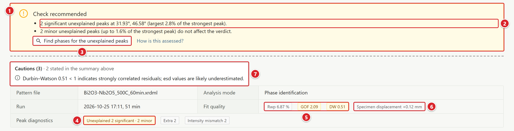{height=125}

(1) Check recommended 배너.
(2) 등급을 낮춘 이유: significant 미설명 피크의 위치와 크기.
(3) Find phases for the unexplained peaks: 피팅 창과 Add phase 창을 함께 열고 그 피크들로 후보 검색을 시작합니다.
(4) Peak diagnostics의 Unexplained 태그: significant·minor 피크 수.
(5) Fit quality: Rwp, GOF, DW 태그. Rwp 태그에 마우스를 올리면 Rp, Rexp, χ², 2θ 범위, 데이터 점 수, 반복 수까지 보입니다.
(6) Specimen displacement 태그: 시료 변위(mm).
(7) Cautions: 자동 점검 결과 모음. 판정과 구분해서 보는 점검 항목입니다. 배너에 이미 나온 항목은 다시 싣지 않고 제목 옆에 "N stated in the summary above"로 개수만 알립니다.

### 상별 판정(Verdict)

정밀화된 상에는 저마다 Confident, Ambiguous, Weak evidence 중 하나가 붙고 태그에 마우스를 올리면 근거 수치를 볼 수 있습니다.

- wt%가 표준편차의 3배 이상이면 Confident 쪽이고 2배 미만이거나 1 wt% 미만이면 Weak입니다.
- 그 상이 빠진 다른 후보의 Rwp가 거의 같으면 Ambiguous가 되며 이때 툴팁에서 대안 후보를 확인할 수 있습니다.
- MP 계산 구조라면 격자가 참조값에서 1.5% 넘게 움직였을 때 감점됩니다.

### 미설명 피크 등급

Unexplained 태그의 숫자는 관측 피크 가운데 계산 패턴이 재현하지 못한 피크의 개수입니다. 이 피크들은 높이(최강 피크 대비)와 S/N으로 나눕니다.

<!-- widths: 90,397 -->
| 등급 | 기준과 영향 |
| --- | --- |
| significant | 최강 피크의 2% 이상이면서 S/N 8 이상. 등급 판정에는 이 종류만 반영됩니다 |
| minor | noise와 significant 사이. 참고용으로만 표시됩니다 |
| instrument | 약한 피크로 위치가 강한 반사의 Cu Kβ, W Lα1 자리와 일치합니다. 장비에서 생겼을 수 있습니다 |
| noise | 최강 피크의 0.5% 미만이거나 S/N 3 미만 |

미설명 피크 위치가 어떤 상의 강한 반사와 맞으면 "Positions are consistent with trace ..." 형태로 미량상 후보가 뜹니다. 판정에는 반영되지 않는 힌트이므로 여기 나온 상은 Add phase로 넣어 검증하세요(6장).

### Cautions와 시료 변위

- Cautions: 자동 점검 결과를 모아 둔 곳입니다. Durbin–Watson 1 미만(esd 과소평가 가능), 넓은 배경 언덕, 질량 균형 같은 항목이 여기 들어갑니다.
- Specimen displacement: 0.3 mm 이하 OK, 0.3 mm 초과 Info, 1.0 mm 초과 Warning, 2.0 mm 초과 Severe.
- 변위가 크면 모든 피크가 한꺼번에 밀리므로 격자상수와 상 매칭 결과를 조심해서 읽고 시료 높이와 장비 프로파일부터 다시 살펴보세요.

## 03 결과 확인 · 후보와 채택

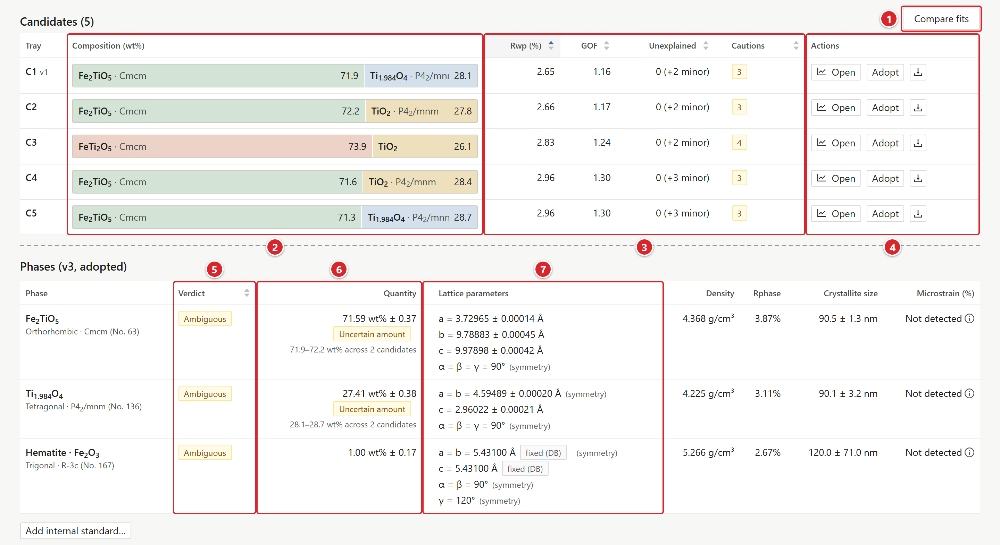{height=266}

(1) Compare fits: 비교 창을 엽니다(6장). 후보가 둘 이상이어야 쓸 수 있습니다.
(2) Composition (wt%): 후보별 상 구성과 wt% 막대. 왼쪽 Tray 열에 C1, C2 … 번호가 붙습니다.
(3) Rwp, GOF, Unexplained, Cautions: 후보별 지표. 머리글을 눌러 정렬합니다.
(4) Actions: Open(피팅 보기), Adopt(채택), 내려받기.
(5) Verdict: 상별 판정(Confident, Ambiguous, Weak evidence).
(6) Quantity: wt% ± 표준편차. 후보마다 값이 갈리면 Uncertain amount 태그와 후보 사이 범위가 붙습니다.
(7) Lattice parameters: 격자상수와 표준편차. DB 값에 고정된 축에는 fixed (DB) 태그가 붙습니다.

Candidates 표의 Confidence 열은 후보끼리 등급이 다를 때만 보입니다.

### 후보 표 읽기

- Candidates 표는 Rwp, GOF, Unexplained, Cautions, Confidence 열로 정렬할 수 있습니다. 선별 단계 값만 있는 후보에는 Screening 태그가 붙습니다.
- 화학식과 공간군이 모두 같고 DB 항목(COD/MP 번호)만 다른 결과는 Rwp가 가장 낮은 하나만 남기고 합칩니다. 합친 경우에는 표 제목 옆에 "N equivalent results merged"가 표시되고 wt% 막대에 마우스를 올리면 같은 상의 다른 DB 항목을 볼 수 있습니다. 공간군이 다른 다형체는 합치지 않고 따로 남깁니다.
- 행을 누르면 그 후보의 피팅이 아래 그래프에 나오면서 페이지 전체가 그 후보 기준으로 바뀌는데 Show v1이나 Show the adopted fit을 누르면 원래대로 돌아옵니다.

### 채택과 메모

- 채택 버튼은 Candidates 표의 Adopt, Adopted fit & notes의 선택 상자와 Save review, Versions 표의 Adopt(6장), 비교 창의 Adopt B(6장)에 있습니다.
- 메모는 Adopted fit & notes에 적고 Save review로 저장합니다. 저장하지 않은 변경이 남아 있으면 보고서를 받을 수 없습니다.
- 자동 최저 Rwp 결과(v1 · Automatic fit)와 채택 결과는 따로 저장됩니다. 제목 줄 Download 메뉴의 보고서, 그림, 내보내기는 채택한 피팅으로 만들고 채택이 없을 때만 v1을 씁니다.
- Quick check 버전은 채택할 수 없습니다(6장).

### Known-phase refinement 결과 줄

Known-phase refinement 작업에서는 Phases 표 아래에 정량되지 않은 상이 한 줄씩 붙습니다. 이 줄들은 자동 피팅(v1) 기준이어서 재정밀화한 버전을 채택하면 작업 페이지에서는 숨겨집니다.

- ZnO: not detected (…): 최종 피팅에 남지 않은 상이며 그 이유가 괄호 안에 붙습니다.
- … no reference structure found (enable Materials Project or add a CIF): 켜 둔 DB에서 구조를 찾지 못한 경우로 이때 전체 등급은 최소 Check recommended가 됩니다.
- … not checked (the time limit was reached): 분석 시간 제한 때문에 확인하지 못했습니다.
- COD에 구조가 없어 Materials Project에서 가져온 화학식도 여기에 표시됩니다.

각 줄의 뜻과 판정 규칙은 7장에서 설명합니다.

### 내부 표준 결과

제출할 때 내부 표준을 넣었으면 Phases 표 아래에 Absolute quantification (internal standard …) 표가 나옵니다. 넣지 않았어도 같은 자리의 Add internal standard…로 나중에 넣을 수 있고 넣은 표준은 Edit로 고치거나 Remove standard로 지울 수 있습니다.

- Of mixture (wt%): 표준물질을 포함한 혼합물 기준 양. Of sample (wt%): 표준물질을 뺀 시료 기준 양.
- Amorphous and unidentified: 모델에 없는 비정질·미동정 성분의 양이며 불확도 2배 안에서 0과 같으면 0 (not detected)로 표시됩니다.
- 표준물질이 피팅된 상에 없으면 절대량은 계산하지 않습니다. 피팅된 표준물질 양이 넣은 양보다 많으면(비정질 분율이 0 미만) 칭량값, 표준물질 순도, 미세흡수를 확인하세요. 표준물질 상이 제대로 정밀화되지 않았으면 절대량이 불확실하다는 경고가 뜹니다.
- 표준물질 화학식과 맞는 피팅된 상이 여러 개면 Choose phase로 표준 상을 고르세요.

## 04 보고서와 내보내기

보고서, 그림, 내보내기는 모두 Download 메뉴에서 받는데 이 메뉴는 세 곳에 있습니다.

<!-- widths: 150,337 -->
| 위치 | 대상 |
| --- | --- |
| 작업 제목 줄 Download | 채택한 피팅. 채택이 없으면 v1 |
| 피팅 창 Download this fit | 지금 보고 있는 피팅(후보, 버전 포함) |
| Versions 표 행 끝 … | 그 버전의 Report (PDF + Word), Report (HTML), Export for… |

<!-- widths: 170,317 -->
| 메뉴 항목 | 내용 |
| --- | --- |
| Report (PDF + Word) | 논문형 영문 보고서. PDF와 편집할 수 있는 Word(.docx)가 ZIP 하나로 묶여 내려옵니다. PC에 Edge나 Chrome이 없으면 PDF 자리에 HTML이 들어갑니다. |
| Report (HTML) | 같은 보고서를 인터넷 없이 열리는 HTML 파일 하나로 받습니다. |
| Figure (PNG) / Figure (SVG) | 600 dpi 피팅 그림과 같은 그림의 벡터 버전 |
| Export for… | Profex / BGMN (.sav + .str), TOPAS (.inp starting model), GSAS-II (CIF + data), HighScore (CIF + data) |
| Table (CSV) | 제목 줄 메뉴 전용입니다. 최종 결과, 채택한 버전, 각 후보의 상별 wt%, 표준편차, 격자상수, 품질 지표 |
| All results (ZIP) | 제목 줄 메뉴에만 있습니다. 계산 산출물 전체(.lst 포함). Candidates 표와 Results 목록의 내려받기 버튼으로도 받습니다. |
| Miller indices on the figure | 메뉴 맨 아래 체크 상자. 켜면 보고서 그림과 Figure (PNG/SVG)의 가장 강한 반사들에 (hkl) 표시가 붙고 이 설정은 이 브라우저에 남습니다. |

- Adopted fit & notes에 저장하지 않은 변경이 있으면 보고서 항목이 Report (save the review first)로 바뀌어 꺼집니다.
- Quick check 버전으로는 보고서도 내보내기도 받을 수 없으니 먼저 Refine all phases로 전체 정밀화 버전을 만드세요(6장).
- 결과 ZIP의 refined_cifs/에 들어가는 CIF는 정밀화된 격자를 넣은 것이고 원자 위치와 점유율은 참조 CIF 값 그대로입니다(구조 정밀화 버전은 6장). 정밀화 구조를 만들지 못한 상은 참조 CIF를 reference_cifs/에 넣습니다.
- Results 목록의 Export table은 여러 작업을 한 표로 묶고 피팅 창 Peaks 탭의 Download CSV로는 반사 목록(hkl, 2θ, d, 강도, FWHM)을 저장합니다.

## 04 보고서와 내보내기 · 보고서 내용

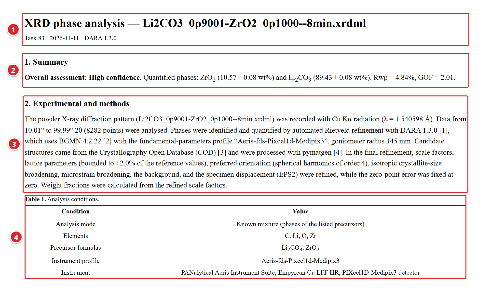{height=290}

(1) 제목 "XRD phase analysis — 파일 이름"과 작성 정보 줄(Task 번호 · 생성 날짜 · DARA 버전).
(2) 1. Summary: 종합 판정, 상별 wt% ± esd, Rwp·GOF. 질량 균형이 어긋났을 때만 그 요약이 붙습니다.
(3) 2. Experimental and methods: 측정·정밀화 방법 문단. DB, 파장, 2θ 범위, 정밀화 조건이 여기에 문장으로 들어가고 참고문헌 번호가 붙습니다.
(4) Table 1. Analysis conditions: 분석 모드, 원소, 전구체 화학식, 장비 프로파일, 장비(Reaction check면 예측 온도).

<!-- widths: 150,337 -->
| 절 | 내용 |
| --- | --- |
| 1. Summary | 종합 판정(High confidence가 아니면 첫 번째 이유), 상별 wt% ± esd, Rwp·GOF. 질량 균형이 어긋났을 때만 그 요약이 붙습니다 |
| 2. Experimental and methods | DARA·BGMN 버전, 파장, 장비, 데이터 범위, 정밀화 변수를 문장으로 적습니다. Table 1 Analysis conditions: 분석 모드, 원소, 전구체 화학식, 장비 프로파일, 장비(Reaction check면 예측 온도) |
| 3. Results | 피팅 그림, Fit statistics 표(Rwp, Rp, Rexp, GOF, 시료 변위), Phase quantification 표(상, 공간군, wt% ± esd, 격자상수, 결정 크기, 미세변형, 판정, 참조). 미세변형 값이 하나도 없으면 그 열은 빠집니다. 내부 표준이나 구조 정밀화가 있으면 해당 소절이 따라붙습니다 |
| 4. Assessment | Phase verdicts, Mass balance, Unexplained peaks, Review cautions. 원소 몰분율 표는 질량 균형이 허용 범위를 벗어났을 때만 들어갑니다 |
| 5. Limitations | 상대 wt%, esd 범위 등 해석상 한계 |
| 6. References | DARA, BGMN, COD, Materials Project, pymatgen 등. Adopted fit & notes에 메모가 있으면 그 앞에 User review notes 절이 생깁니다 |

보고서 표는 모든 열을 가운데로 정렬하고 표 번호는 표가 들어간 순서대로 매깁니다.

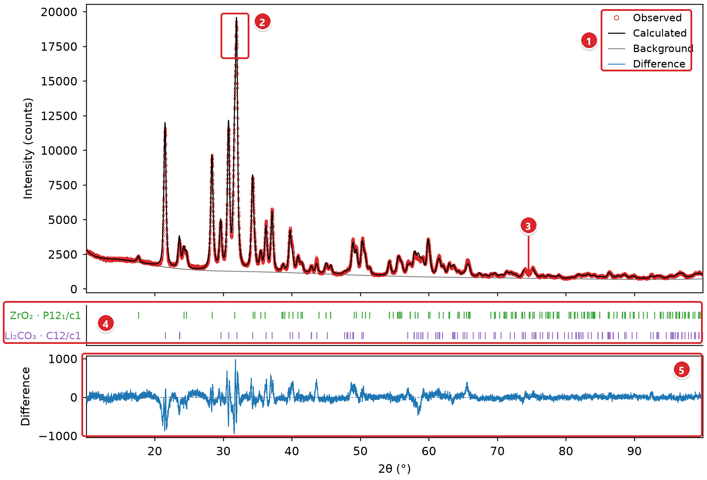{height=280}

(1) 범례: Observed, Calculated, Background, Difference.
(2) 관측(빨간 빈 원)과 계산(검은 선) 패턴. 가장 강한 반사 부근 예시.
(3) Background: 회색 배경 곡선.
(4) 상별 Bragg 반사 위치(세로 막대). 상마다 색이 다릅니다.
(5) Difference: 관측값에서 계산값을 뺀 차이 곡선(파란색).

제외 구간이 있으면 그 자리에 회색 띠를 칠하고 Miller indices on the figure를 켜면 강한 반사 위에 (hkl)이 세로로 붙습니다.

## 05 결과 해석 시 주의

- wt%는 상대값입니다. 모델에 넣은 결정상끼리 합이 100%가 되게 정규화했기 때문에 비정질이나 미동정 물질은 이 값에서 빠져 있습니다. 배경에 넓은 언덕이 보이면 비정질 성분을 의심하고 절대량이 필요할 때는 내부 표준을 쓰세요(2장).
- ± 값은 BGMN이 추정한 표준편차라서 우선 배향, 미세흡수, 시료 변위, 잘못된 구조 모델 같은 계통 오차는 들어 있지 않습니다. Durbin–Watson 주의가 떴다면 실제 불확도는 이보다 큽니다.
- MP 계산 구조는 격자가 몇 %씩 어긋나기 쉽습니다. 최종 상이 계산 구조뿐이면 같은 화학식의 실험 CIF로 다시 정밀화해 보세요.
- 후보를 찾는 범위는 COD, MP, 사용자가 넣은 CIF뿐입니다. 그래서 significant 미설명 피크가 남는다면 원소 목록에서 빠뜨린 원소는 없는지, 새로운 상일 가능성은 없는지 검토하세요.
- High confidence라도 틀릴 수 있으니 시료 이력, 합성 조건, 가능하면 다른 분석법(SEM-EDS, XRF 등) 결과와 대조하세요. 상 조합은 Rwp가 낮다는 것 하나로 확정하지 말고 미설명 피크, 강도 차이, 판정 근거까지 함께 보고 정합니다. 최종 판단과 채택 근거는 Adopted fit & notes의 메모에 남겨 두세요.

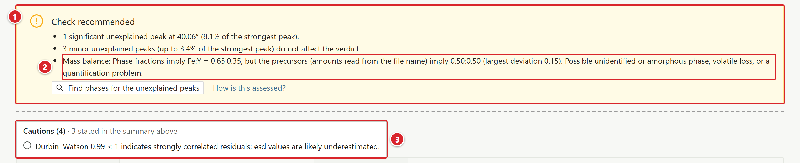{height=100}

(1) 신뢰도 배너. 이 작업은 significant 미설명 피크 1개 때문에 Check recommended이고 질량 균형은 caution 수준이라 등급을 바꾸지 않습니다.
(2) 배너 이유 목록의 "Mass balance: …" 문장. 상 분율로 계산한 Fe:Y = 0.65:0.35, 파일 이름의 전구체 비율 0.50:0.50, 최대 편차 0.15.
(3) Cautions: 배너에 이미 적힌 3개 항목(질량 균형 포함)은 "3 stated in the summary above"로 개수만 표시합니다.

### 질량 균형 점검 읽기

전구체 양이 있는 작업에서만 이 점검이 동작합니다(2장 전구체 양 입력). 정밀화된 wt%를 원소 몰분율로 환산해 전구체의 원소 비와 견주고 원소별 차이 가운데 가장 큰 값(최대 편차)으로 등급을 정합니다. O, H, C, N은 비교 대상에서 빠집니다.

<!-- widths: 110,377 -->
| 최대 편차 | 결과 |
| --- | --- |
| 0.10 이하 | 메시지 없음 |
| 0.10~0.20 | caution. 배너 이유에 한 줄이 추가되고 등급은 그대로입니다 |
| 0.20 초과 | warning. 종합 등급은 최소 Check recommended가 됩니다 |

예를 들어 Fe2O3 + 2 TiO2가 Fe2TiO5 + TiO2로 반응했다면 75/25 wt%가 나와야 하는데 26.8/73.2로 정량되면 Fe:Ti = 0.18:0.82(편차 0.32)여서 warning이 뜹니다.

### 질량 균형 편차의 원인

경고만 보고는 비율이 어긋났다는 사실까지만 알 수 있으므로 원인은 아래 순서로 좁혀 가세요.

- 입력 문제부터 확인하세요. 전구체 양과 파일 이름 속 계수가 실제 칭량과 같은지 대조합니다. 파일 이름에서 숫자 없는 화학식은 계수 1로 읽으므로 Fe2O3-TiO2_800C_60min.xrdml은 1:1(몰)로 해석되고 실제 비율이 다르면 근거 없는 경고가 뜹니다. 이때는 이름에 계수를 넣거나(예: Fe2O3-2TiO2_...) Rerun에서 칸에 양을 직접 적어 다시 제출하세요.
- 고온에서 Bi, Pb, Li, Na, K 등이 일부 날아갔다면 편차는 휘발 손실이라는 실제 현상일 수 있습니다.
- 비정질·미동정 상: 그 상에 들어간 원소가 계산에서 빠지므로 비율이 치우칩니다. 배경 언덕이나 significant 미설명 피크가 있는지 함께 보세요.
- 미반응·누락 상: 남은 전구체나 중간상이 모델에 없으면 편차가 커지므로 힌트가 있을 때 Add phase…로 넣어 비교하세요.
- wt% 자체가 틀렸을 수도 있습니다. 우선 배향, 미세흡수, 잘못된 구조 모델이 이런 정량 문제를 일으키는데 Ambiguous 상이나 Durbin–Watson 주의가 함께 있으면 이쪽을 먼저 의심하세요.

## 06 결과 다듬기 · 피팅 창

이 장에서 다루는 기능은 자동 결과를 검토하고 고칠 때 필요합니다. 처음이라면 3장까지만 읽어도 결과를 확인하고 보고서를 받을 수 있습니다.

작업 페이지에서 Open fit workspace를 누르거나 후보·버전 행의 Open을 누르면 피팅 창(Fit workspace)이 화면을 거의 다 채우며 열립니다. 맨 위 줄에 피팅 선택 상자, Add phase…, Refine 메뉴(Select phases…, Background…, Structure…), Download this fit, Compare…가 있고 그 아래로 적합도 태그, 피팅 그래프, 탭(Phases, Peaks, 구조 정밀화 결과가 있으면 Structure)이 이어집니다.

- 피팅 선택 상자에는 v1 · Automatic fit, 후보(C1, C2 …), 버전(v2, v3 …) 순서로 항목이 나열됩니다.
- Phases 탭: 상 표와 Cautions. 상마다 … 메뉴가 붙습니다(이 장 상 제거와 대안 후보 보기).
- Peaks 탭: 이 피팅의 반사 목록(hkl, 2θ, d, 강도, FWHM). 상별로 걸러 볼 수 있고 Download CSV로 저장합니다.
- 그래프 위 스위치: Scale(강도 축 눈금), Profiles(상별 프로파일), Bragg(Bragg 위치), Markers(미설명 피크 등 진단 표시), Auto-Y.

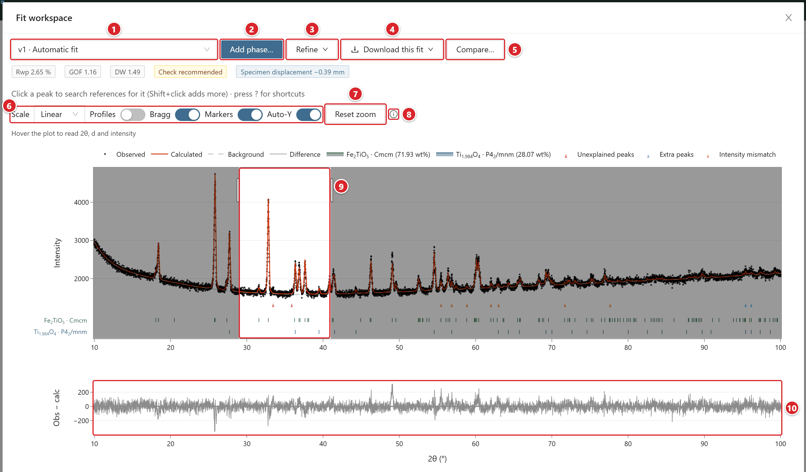{height=248}

(1) 피팅 선택 상자: v1 · Automatic fit, 후보, 버전 가운데 하나를 고릅니다.
(2) Add phase…: 상 추가 창을 엽니다(그림 17).
(3) Refine 메뉴: Select phases…, Background…, Structure….
(4) Download this fit: 지금 보고 있는 피팅의 보고서·그림·내보내기.
(5) Compare…: 비교 창을 엽니다(그림 18).
(6) 그래프 스위치: Scale, Profiles, Bragg, Markers, Auto-Y. Auto-Y는 기본으로 켜져 있고 보이는 2θ 구간에 맞춰 강도 축을 조정합니다.
(7) Reset zoom: 전체 패턴으로 돌아가며 그래프를 더블클릭해도 마찬가지입니다.
(8) ⓘ 아이콘: 마우스를 올리면 조작 안내가 나옵니다.
(9) 확대 상자. 왼쪽 버튼으로 끌어서 그리며 Auto-Y가 켜져 있으면 2θ 범위만 바뀝니다.
(10) 아래 패널(관측-계산). 여기서 상자를 그리면 2θ 범위만 바뀝니다.

### 그래프 조작

<!-- widths: 150,337 -->
| 동작 | 결과 |
| --- | --- |
| 왼쪽 버튼 끌기 | 확대 상자. Auto-Y가 켜져 있으면 2θ 범위만 바뀝니다 |
| Shift+끌기, 오른쪽 버튼 끌기 | 2θ 방향 이동 |
| 마우스 휠 | 커서 위치 기준 2θ 확대·축소(한 칸에 1.25배) |
| 더블클릭, Reset zoom | 전체 패턴 보기로 복귀 |
| 범례의 상 이름 클릭 | 그 상의 프로파일과 Bragg 위치 표시 |
| 점에 마우스 올리기 | 2θ, d(Å), 강도 표시. Bragg 반사 표시 위라면 hkl까지 보입니다 |
| 피크 클릭, Shift+클릭 | 그 피크로 참조 구조 검색(Add phase 창) |

확대·축소와 이동은 측정 2θ 범위 안에서만 되고 비교 창도 피팅 창과 같은 방식으로 움직입니다. 단축키 목록은 피팅 창에서 ?를 누르면 열립니다. 넓은 모니터에서는 작업 페이지 내용이 최대 1920 px 폭까지 펼쳐집니다.

## 06 결과 다듬기 · 빠른 재정밀화와 버전

완료된 작업에서도 상을 더하거나 빼서 그 자리에서 다시 정밀화할 수 있습니다(빠른 재정밀화). 결과는 같은 작업 안에 v2, v3 … 버전으로 쌓이며 원래 자동 분석(v1)은 그대로 남습니다.

- 재정밀화는 피팅 창의 Add phase…, Refine 메뉴(Select phases…, Background…, Structure…), 상 표의 … 메뉴(Refit without this phase…)에서 시작합니다.
- DB를 다시 검색하지 않고 바꾼 상 조합만 정밀화하며 패턴, 장비, 파장, 2θ 범위, 제외 구간, Final refinement controls도 원래 값을 그대로 씁니다.
- 대부분 수십 초 안에 끝나고 한 작업에서는 한 번에 하나만 실행됩니다. 피팅 창을 닫아도 계산은 계속되지만 Cancel하면 버전이 만들어지지 않습니다.
- 끝나면 "Version vN ready (Rwp … %)" 알림과 함께 새 버전이 열립니다. Select phases…나 Refit without this phase…로 만든 버전은 비교 창이 곧바로 열립니다.
- 같은 조건으로 다시 정밀화하면 계산 없이 저장된 버전을 엽니다("Same fit as vN — opened it"). 단 DARA를 업데이트한 뒤라면 같은 조건이어도 새로 계산합니다.
- 예전 버전에서 끝난 작업은 첫 재정밀화 때 Baseline (current code) 버전(지금 코드로 다시 계산한 기준)이 먼저 생기고 이후 비교는 이 버전을 기준으로 합니다.
- 진행 막대에는 대기 중이면 앞 작업 이름과 실행 시간이, 실행 중이면 경과 시간과 예상 총 시간(about N s in total)이 나옵니다. taking longer than usual은 예상 시간을 넘겼다는 뜻일 뿐이니 실패로 보지 마세요.

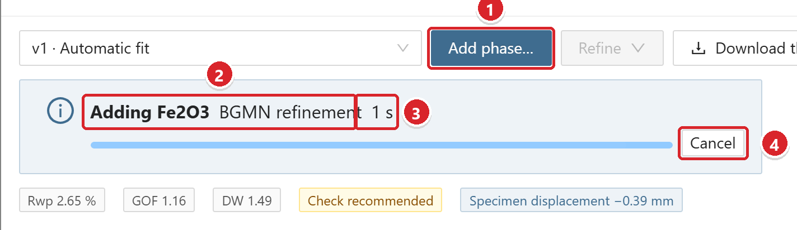{height=120}

(1) Add phase…: 상 추가 창을 엽니다(그림 17).
(2) 진행 막대의 작업 이름(Adding Fe2O3)과 현재 단계(BGMN refinement).
(3) 경과 시간. 대기 중이면 앞 작업 이름과 그 실행 시간이 대신 나옵니다.
(4) Cancel: 진행 중인 재정밀화를 취소합니다.

### 이 밖의 재정밀화

- Select phases…: 이 작업에 저장된 참조 상 목록이 나오면 넣을 상만 체크하고 Refine and compare를 누릅니다. 의심스러운 상을 빼 보거나 같은 화합물의 다른 구조 모델로 바꿔 비교하는 데 알맞습니다.
- Background…: 배경 다항식 항 수와 제외 구간을 바꾸며 항 수를 늘리면 계산이 크게 느려집니다. 배경을 바꾼 버전의 Rwp는 같은 조건의 피팅끼리만 비교하세요.

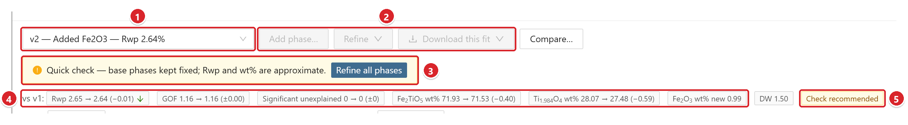{height=70}

(1) 표시할 피팅을 고르는 상자. 새 버전(v2 — Added Fe2O3 — Rwp 2.64%)이 열려 있습니다.
(2) Quick check 버전이라 Add phase…, Refine, Download this fit이 꺼져 있습니다.
(3) Quick check 경고와 Refine all phases 버튼.
(4) "vs v1:"로 시작하는 줄. 기준 피팅 대비 Rwp, GOF, significant 미설명 피크 수, 상별 wt% 변화이며 좋아진 값은 초록, 나빠진 값은 주황으로 칠해집니다.
(5) 이 버전의 신뢰도 등급. 버전마다 따로 판정합니다.

### Versions 표

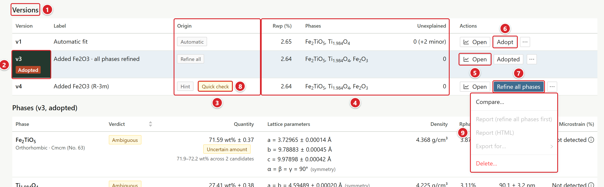{height=151}

(1) Versions 제목.
(2) 채택한 버전 표시(Version 칸의 빨간 Adopted). 버전 번호에 마우스를 올리면 만든 시각이 보입니다.
(3) Origin: 버전을 만든 방법.
(4) Rwp (%), Phases, Unexplained: 버전별 적합도, 상 목록, 미설명 피크 수.
(5) Open: 피팅 창에서 이 버전을 엽니다.
(6) Adopt: 이 버전을 채택하고 현재 메모도 함께 저장합니다. 채택한 행에는 Adopted로 표시됩니다.
(7) Refine all phases: Quick check 행에만 나오며 모든 상을 다시 정밀화합니다.
(8) Quick check 태그.
(9) 행 끝 … 메뉴: Compare…, Report (PDF + Word), Report (HTML), Export for…, Delete…. 쓸 수 없는 항목에는 Report (refine all phases first)처럼 괄호 안에 이유가 붙고 v1과 채택 중인 버전은 삭제할 수 없습니다(Delete (un-adopt first)).

- 행을 누르면 작업 페이지 그래프가 그 버전의 피팅으로 바뀝니다. v1의 Label은 Automatic fit이며 Origin 값은 Automatic(v1), Hint, Peak search, Swap(예전 작업), Remove, Background, Manual(Select phases…), Refine all, Structure, Baseline 중 하나입니다.

## 06 결과 다듬기 · 상 추가

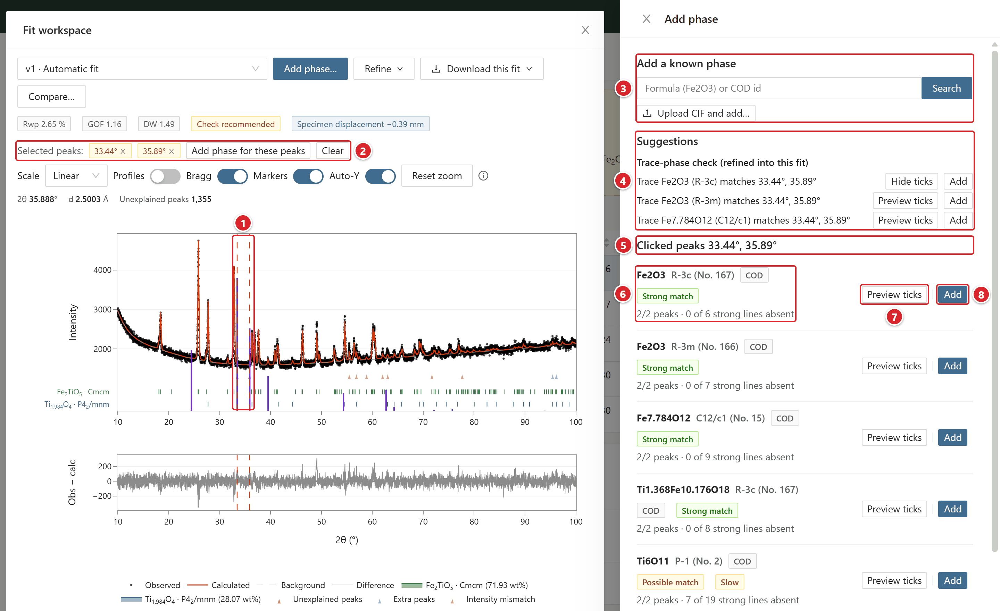{height=298}

(1) 고른 피크 위치(빨간 점선). 보라색 세로선은 Preview ticks로 띄운 후보의 반사 위치입니다.
(2) Selected peaks: 고른 피크 칩(×로 하나씩 해제), Add phase for these peaks, Clear.
(3) Add a known phase: 화학식이나 COD 번호로 찾아 넣거나(Search) CIF를 올려 넣습니다(Upload CIF and add…).
(4) Suggestions: 미량상 힌트 목록(Trace-phase check). 줄마다 Preview ticks와 Add가 붙습니다.
(5) Clicked peaks …: 고른 피크 위치로 찾은 후보 목록.
(6) 후보 정보: 화학식, 공간군, 출처(This task, Library, COD), 일치 강도 태그, 그리고 "2/2 peaks · 0 of 6 strong lines absent"처럼 맞은 피크 수와 측정에 없는 강한 반사 수.
(7) Preview ticks / Hide ticks: 후보의 반사 위치를 그래프에 겹쳐 봅니다.
(8) Add: 이 후보를 넣고 재정밀화합니다.

### Add phase 창 쓰기

피팅 창에서 Add phase…를 누르거나 그래프의 피크를 클릭하면 창이 오른쪽에 열리는데 피팅 창이 왼쪽으로 좁아지므로 그래프는 가려지지 않습니다. Esc는 Add phase 창부터 닫습니다.

- Add a known phase: 넣고 싶은 상을 알고 있으면 화학식(예: Fe2O3)이나 COD 번호로 참조 라이브러리와 COD 목록을 찾아 Add로 넣습니다. Upload CIF and add…로 올린 CIF는 참조 라이브러리에 저장된 뒤 들어갑니다.
- Suggestions: 미량상 힌트가 한 줄씩 나오고 줄마다 Add가 붙습니다. 여기서 추가한 버전은 Origin이 Hint로 표시됩니다(라벨 예: Added Fe2O3). 힌트도 자동 검색 결과도 없을 때는 No suggestions for this fit이 뜹니다.
- Unexplained peaks …: 피팅 창을 열면 significant 미설명 피크 전체로 후보 검색이 자동으로 돕니다. 쓸 만한 후보(Possible match)나 힌트가 있으면 Add phase… 버튼이 파란색으로 바뀌고 후보 개수 배지가 붙습니다. 위쪽 5개만 보이며 나머지는 +N weaker matches로 묶입니다. significant 피크가 없으면 이 목록은 표시되지 않습니다.
- Clicked peaks …: 미설명 피크 표시(삼각형)나 관측점을 클릭하면 그 피크로 검색하고 Shift+클릭으로 피크를 더할 수 있습니다(최대 10개). 첫 검색은 15초까지 걸릴 수 있습니다.
- 이미 들어 있는 상에는 Add 대신 In this fit(지금 피팅) 또는 In vN(다른 버전, 누르면 그 버전이 열림)이 붙습니다.
- 일치 강도: Strong match는 고른 피크를 거의 다 설명하고(점수 0.75 이상) 그 상의 강한 반사 중 측정에 없는 것이 15% 이하인 경우, Possible match는 점수가 0.5를 넘는 경우, Weak match는 일부 피크만 우연히 겹친 경우입니다.
- 자동 검색 목록에는 Strong이 붙지 않습니다. significant 피크 1~2개는 모두, 3~4개는 2개, 5개 이상은 3개 이상을 설명하고 측정에 없는 강한 반사가 15% 이하일 때 Possible match로 표시합니다.
- 상의 존재는 일치 태그 하나로 판정하지 말고 Preview ticks로 다른 반사 위치까지 확인하세요. Add로 넣은 뒤 비교 창에서 Rwp가 뚜렷하게 내려가고 화학적으로도 타당할 때만 채택합니다.
- 힌트와 검색이 보는 구조는 이 PC에 있는 것뿐입니다(작업 후보, 입력 CIF, 참조 라이브러리, 로컬 COD 캐시). 그러니 실제 상이 여기에 없다면 CIF를 구해 입력 CIF나 참조 라이브러리로 추가하세요.
- 후보에 로컬 CIF가 없거나 다른 재정밀화가 도는 중에는 Add가 꺼집니다. 측정 범위 안의 반사가 600개를 넘는 후보에는 주황색 Slow 태그가 붙고 이런 후보를 넣으면 몇 분이 걸릴 수 있습니다.

### Quick check와 Refine all phases

Add로 넣은 상은 빠른 확인(Quick check)으로 계산하는데 기존 상의 격자, 피크 폭, 시료 변위는 기준 피팅 값으로 고정하고 새 상과 배율, 선호 방위만 맞춥니다. 정식 정밀화보다 2~5배 빠르지만 Rwp는 0.1~0.3 높게, wt%는 대략적으로 나옵니다. 새 상이 도움이 되는지 빨리 가늠하는 용도입니다.

- Quick check 버전에는 노란 Quick check 태그가 붙고 채택, 보고서, 내보내기, Download this fit이 모두 막힙니다. 이 버전을 피팅 창에서 열면 Add phase…와 Refine 메뉴도 쓸 수 없습니다(Refine all phases first).
- 비교 창에서 A나 B가 Quick check면 노란 경고가 뜨고 B가 Quick check일 때는 Adopt B가 꺼집니다.
- 결과가 쓸 만하면 Versions 표의 해당 행이나 피팅 창 경고에 있는 Refine all phases를 누르세요. 그러면 모든 상을 다시 정밀화한 버전(Origin: Refine all)이 생기고 원래 Quick check 버전은 지워집니다. 계산이 끝나면 새 버전과 Quick check의 기준 피팅이 비교 창에 뜹니다.

### 상 제거와 대안 후보 보기

피팅 창 Phases 탭에서 각 상의 … 메뉴를 엽니다.

- Refit without this phase…: 이 상만 빼고 다시 정밀화해 새 버전을 만든 뒤 비교 창을 엽니다. 상이 2개 이상일 때만 메뉴에 보입니다.
- View C2 등(대안 후보 번호): Ambiguous로 판정된 상의 대안 후보에 저장해 둔 피팅으로 화면만 바꿉니다. 새 버전은 만들지 않습니다.

## 06 결과 다듬기 · 구조 정밀화와 비교

### 구조 정밀화(Structure…)

피팅 창 Refine 메뉴에서 Structure…를 누르면 오른쪽에 Refine structure 창이 열립니다. 이 창에서는 한 상의 원자 위치, 열진동(B), 점유율을 풀어 새 버전으로 정밀화하는데 실험실 X선 데이터로 얻은 값은 참고값(indicative)입니다.

1. Phase에서 상을 고릅니다. 쓸 수 없는 상은 (not available)과 그 이유가 함께 표시됩니다.
2. Sites 표에서 좌표를 풀 자리를 체크하세요. 풀리는 좌표는 Wyckoff 위치가 허용하는 것(Free)뿐이고 시작값은 DB CIF 값입니다.
3. Thermal displacement (B)에서 Fixed at 1.0 Ų, One B for the phase, One B per element 중 하나를 고릅니다.
4. Occupancy에서는 필요할 때 Add constraint로 Exchange(두 자리 원소 교환), Substitution(자리에 도펀트), Vacancy(자리 일부 빔) 제약을 더합니다(최대 6개). 어느 자리든 점유율 합은 늘 1로 유지됩니다.
5. Parameters 줄에서 변수 수를 확인한 뒤 Refine as new version을 누릅니다.

- 정밀화할 상은 5 wt% 이상이면서 새로 추가한 상이 아니어야 하고 점유율은 10 wt% 이상인 상만 풀 수 있습니다. 또 기준 피팅이 Rwp 15% 이하, GOF 4 이하여야 하며 그 상의 격자가 먼저 정밀화되어 있어야 합니다(고정이거나 한계에 닿으면 불가).
- 변수는 최대 12개까지 쓸 수 있고 반사 수의 1/5을 넘지 못합니다. 수소 위치와 점유율, X선 산란이 비슷한 원소 쌍의 점유율은 풀 수 없습니다.
- 결과는 Origin이 Structure인 버전으로 저장되어 피팅 창 Structure 탭에서 볼 수 있고 보고서에는 Structure refinement (indicative) 소절이 추가됩니다.

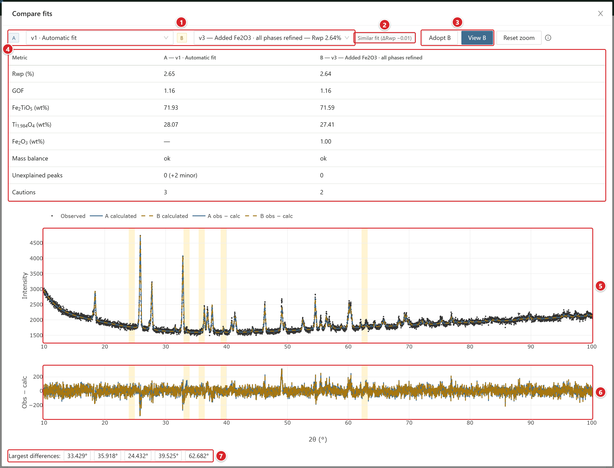{height=371}

(1) Fit A / Fit B 선택 상자. v1, 후보, 버전 가운데 하나를 고릅니다.
(2) 판정 태그(A fits better, B fits better, Similar fit). 괄호 안 값은 B - A의 Rwp 차이입니다.
(3) Adopt B / View B: B 채택, B를 피팅 창에서 열기. 채택을 그대로 두려면 창을 닫으세요.
(4) 지표 표: Rwp, GOF, 상별 wt%, Mass balance(점검이 있을 때만), Unexplained peaks, Cautions.
(5) 관측점과 두 계산 패턴. A는 파란 실선, B는 주황 점선입니다.
(6) 두 피팅의 관측-계산 잔차.
(7) Largest differences: 두 계산 패턴의 차이가 가장 큰 2θ 위치. 누르면 그 구간으로 확대되고 그래프에는 노란 띠로 보입니다.

### 두 피팅 비교

- Candidates 표 제목 옆 Compare fits(A는 채택한 피팅 또는 v1, B는 보고 있는 피팅 또는 다음 후보), 피팅 창의 Compare…, Versions 표 … 메뉴의 Compare…에서 열 수 있습니다. Select phases…와 Refit without this phase… 뒤에는 자동으로 열립니다.
- 비교는 같은 작업의 두 피팅끼리만 됩니다. 다른 시료와 견주려면 Results의 Compare selected를 쓰세요. 창을 닫아도 B 버전은 Versions 표에 그대로 남습니다.
- 노란 띠로 알 수 있는 것은 두 모델이 갈리는 구간까지이고 어느 쪽이 맞는지는 띠만으로 알 수 없습니다. Rwp 하나에 기대기보다 잔차, 화학 조성, 물리적 타당성을 함께 보세요.

## 07 특수 기능

### Known-phase refinement 세부 규칙

적은 화학식(최대 12개, 같은 화학식은 한 번만 셉니다)마다 결과가 하나씩 정해지고 피팅에 넣는 구조도 화학식마다 하나뿐입니다. 상이 피팅에 남으려면 significant 또는 minor 미설명 피크를 설명해야 합니다. 판정은 다음 두 단계를 거칩니다.

1. 빼 보기: 5 wt% 미만인 상을 가벼운 것부터 하나씩 빼고 다시 피팅해서 미설명 피크가 늘지 않으면 그 상을 뺍니다. 업로드한 CIF 구조와 마지막 남은 상은 빼지 않습니다.
2. 더해 보기: 검색 결과에 없는 화학식은 그 화학식의 가장 나은 구조를 더해 시험 피팅하고 미설명 피크가 줄 때만 남깁니다. 1단계에서 뺀 화학식은 다시 시도하지 않습니다.

<!-- widths: 190,297 -->
| 결과 줄 | 뜻 |
| --- | --- |
| not detected (a trial fit gave X wt% but explained no additional peak) | 빼 보거나 더해 봐도 새로 설명되는 피크가 없어 뺐습니다 |
| not detected (a trial fit with it failed) | 시험 피팅이 수렴하지 않았습니다 |
| not detected (refined to X wt%, removed) | 정밀화했지만 최종 피팅에서 빠졌습니다 |
| not detected (no phase combination fitted the pattern) | 패턴에 맞는 상 조합을 검색에서 하나도 찾지 못했습니다 |
| not checked (the time limit was reached) | 분석 시간 제한에 걸려 확인하지 못했습니다 |
| no reference structure found (enable Materials Project or add a CIF) | 켜 둔 DB에 구조가 없습니다. 이때 전체 등급은 최소 Check recommended이고 이 문장은 판정 사유에 늘 들어갑니다 |

- 검출 한계는 숫자로 제시하지 않습니다.
- 적은 화학식 모두에서 구조를 찾지 못하면 작업이 실패하며 실패 메시지에 해당 화학식이 표시됩니다.
- 올리거나 라이브러리에서 고른 CIF의 화학식이 적은 화학식과 같으면 그 CIF를 해당 화학식의 구조로 씁니다. 이때는 COD나 MP에서 다시 찾지 않고 결과에도 한 줄만 나옵니다.
- COD에 구조가 없는 화학식은 MP API 키가 있을 때 Materials Project에서 자동으로 가져옵니다. 이 동작은 그 실행에만 적용되므로 MP 스위치와 저장된 설정은 바뀌지 않습니다. COD에 구조가 있는 화학식이라면 MP 구조를 쓰지 않습니다.

### 상 구성 재사용

작업 페이지 제목 줄 … 메뉴에서 Use these phases for other files…를 누르면 Known-phase refinement로 고정된 Submit 화면이 열리는데 화학식 칸 대신 Phases from Task N: 화학식 · 공간군 목록이 보입니다.

- 채택한 결과가 있으면 그 상을, 없으면 자동 피팅의 상을 씁니다.
- DB를 다시 찾지 않고 그 결과의 구조 그대로 모든 파일을 정밀화하므로 온도별·배치별 격자상수와 크기 추세가 서로 다른 참조 구조에서 나오는 일이 없습니다.
- Use these phases for a series…를 고르면 같은 상 구성으로 시리즈를 제출합니다.
- 일반 입력으로 돌아가려면 Enter formulas instead를 누르세요.
- 새 작업에는 어느 작업에서 가져왔는지(phase set from Task N)가 기록되므로 다시 실행해도 저장된 구조를 그대로 씁니다. 저장된 구조를 유지한 채 제출하면 서버는 입력한 화학식을 무시하고 저장된 집합과 다르면 제출 직후 경고를 띄웁니다.

### 시리즈 분석

온도별, 시간별, 조성별처럼 같은 조건으로 측정한 패턴 여러 개를 한 번에 분석해 추세를 봅니다.

1. Submit 화면에서 Submit as a series를 켭니다.
2. Series name을 넣고 XRD patterns에 파일 2~50개를 한꺼번에 올립니다. 파일 형식과 측정 조건은 모두 같아야 합니다.
3. Series order preview에서 파일 이름으로 읽어 낸 변수(예: 200 °C, 60 min)와 순서를 확인합니다. 이 값은 그래프 축에만 쓰입니다.
4. Submit series를 누르면 각 파일이 같은 설정의 독립 작업으로 처리됩니다.

상단 Series 메뉴에서 시리즈를 고르면 작업 표와 추세 그래프가 나오는데 그래프는 완료된 작업이 2개 이상일 때부터 그려집니다.

- Phase fractions: 상별 wt%와 오차막대
- Lattice parameters: 격자 변화
- Fit quality: 시료별 Rwp와 GOF
- Export CSV로 표를 저장하고 Compare patterns로 패턴을 겹쳐 봅니다.

## 08 문제 해결

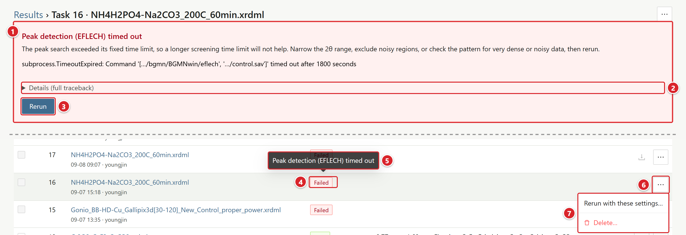{height=167}

(1) 실패 원인 요약과 조치 힌트.
(2) Details (full traceback): 오류 전체 기록을 펼칩니다.
(3) Rerun: 원래 패턴과 조건이 채워진 Submit 화면을 엽니다. 자동 조치가 있는 원인이면 옆에 Retry with suggested fix (…) 버튼도 함께 나옵니다.
(4) Results 목록의 Failed 태그.
(5) 태그에 마우스를 올리면 뜨는 원인 요약.
(6) 행 끝 … 버튼.
(7) … 메뉴: Rerun with these settings…, Delete…. 자동 조치가 있는 원인이면 Retry with fix (…)도 들어갑니다.

### 실패 작업 재시도

Retry with suggested fix (…)를 누르면 바뀔 설정이 먼저 표시되고 확정하면 새 작업이 생기며 실패한 작업은 그대로 남습니다. 자동 조치가 없는 원인이라면 Rerun에서 값을 고쳐 다시 제출하세요.

<!-- widths: 150,337 -->
| 원인 | 자동 조치 |
| --- | --- |
| 계산 시간 초과 | 선별 시간 제한 2배, Maximum analysis time 1.5배 |
| MP 키 문제, 네트워크 오류 | MP 끄기 |
| 메모리 부족 | Candidate pre-filter 켜기, MP 구조 수 최대 50 |
| 후보 구조 없음 | COD 켜기, MP 구조 수 늘리기 |
| 모든 후보 최종 정밀화 실패 | 격자 변화 3% 제한 |
| EFLECH 시간 초과, 피크 없음, BGMN·Ray 오류 | 자동 조치 없음. 2θ 범위를 좁히거나 잡음 구간을 빼고 다시 제출하세요 |

### 자주 겪는 상황

<!-- widths: 140,347 -->
| 상황 | 확인과 대처 |
| --- | --- |
| 첫 실행이 실패할 때 | 인터넷과 프록시를 확인한 뒤 START.cmd를 다시 실행하세요. 이미 받은 파일은 다시 쓰입니다. 원인은 START 창의 마지막 메시지와 artifacts\launcher\setup-*.log에서 찾을 수 있습니다. |
| 폴더를 옮긴 뒤 실행되지 않을 때 | START가 알아서 다시 구성하고 그래도 안 되면 START.cmd -Reinstall을 실행하거나 .venv 폴더를 지운 뒤 다시 실행하세요. |
| MP key rejected / not configured | 9장 MP 키 바꾸기를 따르세요. 급하면 MP를 끄고 COD와 CIF로 분석하면 됩니다. |
| 서버가 혼자 꺼질 때 | 창을 모두 닫으면 꺼지게 되어 있는 정상 동작입니다(1장 종료). START.cmd로 다시 실행하고 "Unexpected shutdown of the worker process"가 뜬 작업은 다시 제출하세요. |
| 웹 화면이 열리지 않을 때 | http://localhost:8898을 직접 입력해 보고 회사 프록시가 로컬 주소를 가로채지 않는지도 확인하세요. |
| 분석이 너무 느릴 때 | 전구체를 알면 Reaction check로 돌리세요. 그렇지 않다면 Candidate pre-filter 켜기, MP 구조 수 줄이기, Maximum analysis time 지정, 2θ 범위 좁히기 순서로 시도해 봅니다. |
| COD 연결 오류, CERTIFICATE_VERIFY_FAILED | 인터넷·프록시부터 확인하세요. 기관망이 HTTPS를 검사하는 환경이면 START.cmd를 다시 실행할 때 인증서 묶음이 자동으로 만들어집니다. 그래도 계속 실패하면 CIF를 직접 올려 분석합니다. |
| No candidate structures were found | 원소 목록과 COD/MP 스위치를 다시 확인하고 그래도 후보가 없으면 참조 CIF를 올리세요. |
| BGMN refinement program failed | 흔한 원인은 이상한 CIF나 프로파일·파장 불일치이므로 의심 CIF를 빼고 장비 프로파일을 다시 확인하세요. |
| The parallel worker (Ray) could not start | 다른 DARA 창을 닫거나 PC를 다시 시작하세요. 보안 프로그램이 로컬 포트를 막고 있지 않은지도 살펴봅니다. |
| 질량 균형 경고가 뜰 때 | 5장 질량 균형 점검 읽기와 편차의 원인을 참고하세요. |
| 보고서 ZIP에 PDF 대신 HTML이 있을 때 | PC에 Edge나 Chrome이 없어 PDF로 인쇄하지 못한 경우이므로 HTML을 브라우저로 열어 PDF로 저장하세요. |
| 재정밀화가 오래 걸리거나 실패할 때 | 재정밀화와 최종 정밀화는 CPU 코어를 여러 개 쓰므로 다른 무거운 프로그램을 닫으면 빨라집니다. 배경 항 수를 Auto로 되돌리거나 불필요한 상을 빼 보세요. 다른 재정밀화가 도는 동안에는 버튼이 꺼져 있으니 기다리거나 Cancel합니다. |
| Adopt, 보고서, Add phase…가 꺼져 있을 때 | Quick check 버전이라서 그렇습니다. Refine all phases로 전체 정밀화 버전을 만든 뒤 그 버전으로 진행하세요(6장). |
| 재정밀화를 눌렀는데 바로 끝날 때 | 같은 조건의 버전이 이미 있으면 그 버전을 바로 엽니다("Same fit as vN — opened it"). 조건을 바꾸지 않았다면 정상입니다. |
| 피팅이 나쁠 때 | 파장, 장비 프로파일, 원소 목록, 후보 CIF, 분석 범위 순서로 확인하세요. Rwp를 낮추려고 중요한 피크를 제외 구간으로 지우면 안 됩니다. |

## 09 부록

### MP API 키 받기

MP API 키는 무료이며 가입하면 자동으로 만들어집니다.

1. 브라우저로 [https://materialsproject.org](https://materialsproject.org/)에 접속합니다. 처음에는 사람 확인(Cloudflare) 화면이 잠깐 나올 수 있습니다.
2. 오른쪽 위 로그인 메뉴에서 가입하거나 로그인하는데 이메일과 연동 계정 중 편한 쪽을 고르면 됩니다.
3. 로그인한 상태에서 위쪽 메뉴의 API를 누릅니다(주소 [https://next-gen.materialsproject.org/api](https://next-gen.materialsproject.org/api)).
4. API Key 항목의 "Your API Key" 상자에 나온 문자열 전체를 앞뒤 공백 없이 그대로 복사합니다.
5. START.cmd 첫 실행 때 뜨는 입력 창(그림 1)에 붙여 넣습니다.

- 키는 비밀번호처럼 다뤄야 하므로 공개 문서, 메신저, Git에 올리면 안 됩니다.
- 키가 새어 나갔다면 같은 페이지 아래 dashboard 링크에서 새 키를 받고 예전 키는 폐기하세요.

### MP 키 바꾸기·나중에 넣기

키를 잘못 넣었거나 새로 받았거나 처음에 Skip for now를 눌렀다면 입력 창을 다시 열어 키를 넣으세요.

1. DARA 폴더(START.cmd가 있는 폴더)를 탐색기로 엽니다.
2. 탐색기 주소창에 cmd를 입력하고 Enter를 누르면 그 폴더에서 명령 창이 열립니다.
3. START.cmd -SetApiKey를 입력하고 Enter를 누르면 그림 1의 입력 창이 다시 뜹니다.
4. 새 키를 붙여 넣고 Save and continue를 누릅니다. Skip for now를 누르면 기존 키가 그대로 유지됩니다.
5. 서버가 켜져 있었다면 "Restart required" 안내가 뜨는데 START 창을 닫고 START.cmd를 다시 실행해야 새 키가 적용됩니다.

### 장비 프로파일 등록

Instrument profile 목록에 실제 장비, 검출기, 슬릿 조건에 맞는 항목이 없을 때만 등록하세요. Submit 화면에서 Register profile…을 누른 뒤 두 방법 중 하나를 고릅니다.

- Instrument setup: 장비 사양서 값(고니오미터 반경, 발산 슬릿 고정 각도 또는 자동 조사 길이, 솔러 각도, 빔 마스크, 산란방지 슬릿, 시료 직경, 검출기 종류와 크기, 단색화기)을 mm와 ° 단위 그대로 입력합니다. Bruker 솔러 슬릿을 쓴다면 Bruker Soller slits를 체크하세요. 그러면 DARA가 BGMN(GEOMET, MAKEGEQ)으로 .geq를 계산해 등록하는데 최대 10분 정도 걸립니다.
- Upload GEQ file: 장비 담당자에게 받은 .geq(대응 .ger 포함)를 올립니다. .xrdml 측정 파일은 확장자만 바꿔서는 .geq가 되지 않습니다.

등록한 프로파일은 교정을 거친 것이 아니므로 결정 크기나 변형률을 믿기 전에 표준시료(Si, LaB6)를 피팅해 확인하세요. 목록에는 표준시료 검증 여부(operator verified / unverified)도 함께 표시됩니다.

### 표준시료로 프로파일 교정

Instrument setup으로 만든 프로파일이나 기본 템플릿처럼 장비 설정 파일(.sav)이 있는 프로파일은 표준시료 측정 패턴으로 교정할 수 있습니다. 업로드한 .geq 프로파일에는 .sav가 없어서 교정할 수 없습니다.

1. Instrument profile에서 교정할 프로파일을 고르고 Register profile… 옆의 Calibrate with a standard…를 누릅니다.
2. 표준시료(LaB6, Si, Al2O3 커런덤)와 파장을 고르고, 같은 장비·슬릿 조건으로 측정한 표준시료 패턴 파일을 올린 뒤 Start calibration을 누릅니다. 파일 형식은 Submit과 같습니다.
3. DARA는 검출기 폭(DetW) 하나만 바꿔 가며 프로파일을 최대 6번 다시 계산하고, 그때마다 시료 기인 폭 넓어짐(결정 크기·변형률)을 끈 채 격자상수, 영점, 시료 높이만 풀어 표준시료를 정밀화합니다. Rwp가 가장 낮은 DetW를 고릅니다. 한 번 계산에 몇 분씩 걸려 전체는 수십 분이 걸리며, 창을 닫아도 서버에서 계속 진행됩니다.
4. 끝나면 DetW와 Rwp의 교정 전후 값, 그리고 크기 정밀화를 켰을 때의 겉보기 결정 크기가 표시됩니다. 결과는 "<원래 이름> · calibrated (LaB6, 날짜)"라는 새 프로파일로 저장되고 바로 선택되며, 원래 프로파일은 그대로 남습니다.

표준시료의 겉보기 결정 크기는 커야 정상입니다. 값이 작게 나오면 장비 기인 폭 넓어짐이 아직 프로파일에 다 들어가지 않았다는 뜻이므로 장비 설정값을 다시 확인하세요. 교정된 프로파일로 분석하면 보고서의 Methods 문단에 어떤 표준시료로 DetW를 맞췄는지 함께 적힙니다. 서버를 다시 시작하면 진행 중이던 교정은 사라집니다.

### 참조 CIF 구하기

[COD](https://www.crystallography.net/cod/)나 논문 보충자료에서 구하고 이용권이 있다면 ICSD에서도 받을 수 있습니다. 쓰기 전에 원소, 공간군, 출처를 확인하세요. 검색 결과 HTML을 .cif로 이름만 바꾼 파일은 읽히지 않습니다.

### 업데이트

새 버전은 바뀐 파일만 받아 적용하므로 Git은 필요 없습니다.

- START.cmd를 실행하면 먼저 GitHub에 새 버전이 있는지 확인합니다. 새 버전이 있으면 날짜, 변경 내용 한 줄, 받을 파일 수와 크기가 표시되고 "Update now? [Y/n]"을 묻습니다. Enter나 Y를 누르면 바뀐 파일만 받은 뒤 START가 새 파일로 다시 실행되고 N을 누르면 지금 버전으로 시작합니다.
- 업데이트만 하려면 DARA 폴더의 UPDATE.cmd를 더블클릭하세요.
- 받은 파일은 모두 확인(해시 대조)을 마친 뒤에 한꺼번에 바꾸기 때문에 중간에 인터넷이 끊겨도 아무것도 바뀌지 않습니다.
- .venv, tools, MP 키, 분석 결과 DB는 건드리지 않습니다. 패키지 목록이 바뀐 업데이트라면 다음 START 실행 때 필요한 패키지만 추가로 설치합니다.
- 인터넷이 없거나 GitHub에 접속할 수 없으면 확인을 건너뛰고 지금 버전으로 시작합니다.

UPDATE.cmd가 없는 예전 설치본이라면 처음 한 번만 직접 받아야 합니다. 저장소 페이지에서 UPDATE.cmd를 열고 오른쪽 위 다운로드 버튼(Download raw file)으로 받은 뒤, 지금 쓰는 DARA 폴더(START.cmd가 있는 곳)에 넣고 더블클릭하세요. 그다음부터는 START.cmd만 실행해도 새 버전을 확인합니다.

### START 선택 스위치

| 스위치 | 동작 |
| --- | --- |
| -Reinstall | .venv 재설치 |
| -Offline | 네트워크를 쓰지 않음 |
| -SetupOnly | 설치만 하고 서버는 켜지 않음 |
| -NoBrowser | 브라우저를 열지 않음 |
| -SkipApiKeySetup | MP 키 입력 창 생략 |
| -SetApiKey | MP 키 입력 창 다시 열기 |
| -NoUpdateCheck | 새 버전 확인 생략 |

### 폴더 안내

- src, scripts, pyproject.toml은 지우거나 옮기면 안 됩니다. tools와 .venv는 첫 실행 때 만들어지는 폴더입니다.
- 분석 데이터는 DARA 폴더와 별개로 사용자 홈의 .dara-server 폴더에 저장됩니다. 백업하려면 서버를 끈 뒤 그 폴더를 복사하세요.
