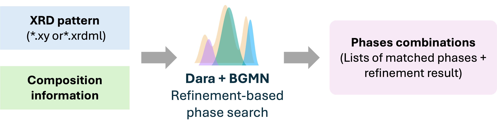

# DARA Server Tutorial

<p align="center">

</p>
<p align="center" style="font-size:1.05em; color: #3a3a3a">
DARA is designed for <strong>automated phase identification and refinement</strong> for powder XRD data.
</p>

## Overview

The DARA server provides a web-based interface for automated phase identification from powder X-ray diffraction (XRD) data.

## Getting Started
You'll see the main interface with navigation options:

- **Submit**: Upload and analyze new XRD patterns
- **Results**: Browse all submitted analyses
- **Series**: Analyse several patterns (for example a temperature series) together and plot trends
- **Help**: this tutorial and the documentation of the DARA package.

## Submitting an Analysis

### Step 1: Navigate to Submit Page

Click on "Submit" in the navigation menu to access the submission form.

### Step 2: Upload Your XRD Pattern

**Supported File Formats:**
- `.xy` - Two-column ASCII format (2θ, intensity)
- `.txt` - Text files with diffraction data
- `.xye` - Three-column format (2θ, intensity, error)
- `.xrdml` - PANalytical/Malvern Panalytical XML format
- `.raw` - Rigaku/Bruker raw data format
- `.rasx` - Rigaku RASX powder diffraction format

### Step 3: Choose the Analysis Mode and Enter the Chemistry

Select one of four analysis modes. The fields below the selector change with the mode.

The first two modes are one flow at two depths, with the same input (the elements, or the formulas of the starting materials or the expected phases):

- **Search-match** (the default): peak matching against the database in seconds, as HighScore and Match! do. The phases are found by peak matching and are not verified by a fit. See [Search-match and identification](#search-match-and-identification).
- **Rietveld phase search**: the automatic phase search (minutes). DARA refines the candidate phase sets and ranks them by the fit, so the result is a verified phase set with wt%.
- **Known-phase refinement**: DARA refines only the phases you list under "Phases to refine". Use it when you already know what is in the sample.
- **Reaction check**: DARA compares your formulas with a predicted reaction at a given temperature (27 to 1727 °C) and atmosphere.

**Precursor Formulas:**
Enter the chemical formulas of your starting materials, separated by commas.
```
CaO, TiO2
```

or you can write the target phase formula in the text box, like
```
CaTiO3
```

DARA only needs to know what elements are needed to include for the search.

### Step 4: Configure Analysis Parameters

**User Identification:**
Enter your username for tracking and organization purposes. You can use this option to better organize your patterns.

**Instrument Profile:**
Select your diffractometer configuration from the dropdown.

**Reaction check (only in Reaction check mode):**
- **Temperature**: Specify the reaction temperature in Celsius (27 °C minimum, 1727 °C maximum)
- **Atmosphere**: Select the atmosphere of the reaction

### Step 5: Run

The Run card has one main action per mode:

- **Identify**: **Search-match** opens the search-match for the pattern (seconds). With several files it becomes **Identify all (N)** (see below).
- **Rietveld phase search** and the other Rietveld modes: **Run analysis** queues the automatic analysis. **Check candidates first** opens the same search-match before you commit to the run.

Errors in the form are marked at their field; otherwise the task appears in Results.

## Search-match and identification

Search-match ranks reference structures against your pattern in seconds, as HighScore and Match! do. Choose the **Search-match** mode, load a pattern, enter the elements or formulas, then click **Search-match** in the Run card. (In the Rietveld modes the same search-match is **Check candidates first**.)

- The candidate table lists the matching structures with their score and how much of the pattern they explain. Click a candidate to preview its reflections on the pattern; tick it to select it.
- **Pattern / Residual** switches the plot between the net pattern and what the selected phases leave. The unexplained peaks are marked on the plot and listed beside it with 2θ, d and height; click one (or press Enter on it) to see the candidates with a strong line there, preview their reflections and add one.
- Candidates whose strong peaks fall on the same positions as a selected phase (a polymorph or a close-composition variant) are listed as **Alternatives** under it, and marked *alt.* in the table instead of a rank: peak matching cannot tell them apart. **Tell apart with Rietveld** refines the selected phases together with them.
- **Background** (its button shows the method in use) holds everything about the background removed before ranking: **Show on plot**, and the method: Automatic, Granularity / bending as in HighScore, or Manual points dragged on the plot. The curve is drawn on the pattern while you move the sliders; "Accept and rank again" ranks with it. The fit view's Background (Refine menu) uses the same words: Automatic, Polynomial terms or Manual points.
- **Refine with Rietveld** submits a Known-phase refinement of the selected structures (minutes).
- **Save identification** stores the selected phases as the result without refinement. An identification has no Rwp; its amounts are estimated from reference intensity ratios (RIR).

An identification is marked **Peak matching only · not verified by a fit**. **Refine with Rietveld** on its page verifies the phases with a fit (a new, linked task); once that is done, both pages say whether the two found the same phases and list the phases found by only one of them. Alternatives saved with a phase can be refined with it from the phase table (**Tell apart with Rietveld**).

To change the phases of a saved identification, open its task and click **Edit phases (Search-match)**: the search-match opens again on the stored pattern with those phases selected. Saving makes a new task; the first one is kept.

### Several files: Identify all

Drop several files on the pattern field (or switch on **Several files**). In the Identify mode the main action becomes **Identify all (N)**: each file gets a search-match with the same settings, and its suggested phases (the suggestion without the weak picks, as "Use suggestion" would tick) are saved as one identification per file. The files are grouped as a series under the series name (filled in from the file names), so they appear together in Results and Series.

- The files table shows each file's result as it arrives: the task and its phases, or why the file failed (for example an unreadable file or another radiation). The other files go on.
- Files of different samples: switch on **Use each file's own elements** in the note above the table, and each file is searched with the elements of its own name.
- Each row says *not verified*: tick the files to check and click **Verify selected with Rietveld** to queue a Known-phase refinement of each (minutes per file).
- Each identification can be changed afterwards with **Edit phases (Search-match)**.

## Results

Navigate to "Results" to follow and review the submitted analyses. The list updates by itself while tasks are queued or running.

**Columns:**
- **ID**: task number.
- **Name**: the sample name, then the file name in smaller type. A long file name keeps its end (for example `--8min.xrdml`). The red mark (`v1`, `v2`, `#3`) shows which fit is adopted; "rerun of #120" links to the task it was copied from. Running tasks show their stage and progress under the name, queued tasks their place in the queue, failed tasks the reason.
- **Verdict**: for a completed task, the confidence of the result: **High**, **Check** or **Expert review**; **No fit** when the search found no phase set. Other tasks show their state: Queued, Running, Stopping, Failed or Cancelled. Red is used for failures only.
- **Rwp (%)** and **GOF**: of the adopted fit, or of the automatic fit when nothing is adopted.
- **Final phases**, **Submitted** (date and time) and **User**.

Click a column title to sort by name, verdict, Rwp, GOF or submission time; the sort applies to every page.

**Filters:** search the sample or file name, pick **My tasks** (the user name you last submitted with) or **All users**, or type part of a user name. **Status** and **Verdict** narrow the list further; **Clear filters** removes them. Filters, sort, page and selection stay in the address, so Back from a task returns to the same view.

**Reviewing several samples:** open a task from the list. The arrows beside the task title (or the `[` and `]` keys) open the previous and next sample of the list page, and the "Results" link returns to the same view.

**Selected tasks:** tick rows on any page.
- **Compare patterns** overlays 2 to 20 completed patterns (stack, map or difference).
- **Export table (CSV)** writes one row per phase of the adopted fit of each selected task; its menu also exports every task matching the filter. The first export of a set takes 10–20 s per 50 tasks.
- The **selected** menu retries failed tasks whose failure is usually temporary, deletes the selected tasks (queued and running tasks are skipped) or clears the selection.

Each row's download button saves that task's results as a ZIP; its **More actions** menu reruns the task with the same settings, retries a failed task, stops a running one or removes a queued one from the queue.

## Advanced analysis tools

**Help → Advanced analysis tools** switches on the specialist tools on the task page: crystallite size and strain, unit cell, RIR quantification, Le Bail fit and the instrument FWHM curve. The setting is kept per browser; the routine result (fit, phases, amounts, exports) does not need it.

## Interpreting Results

### Task Details Page

Click on any completed analysis to view detailed results:

### Status Information
- **Task Label**: Original filename
- **Status**: Final processing state
- **Runtime**: Total computation time
- **Timestamps**: Submission, start, and completion times

### Phase Identification Results

**Best Fit (Rwp):**
A numerical value indicating fit quality (lower numbers indicate better fits).

**Identified Phases:**
- **Representative Phases**: Primary phase in each compositional group
- **Phase Groups**: Related phases grouped by composition
- **Highlighted Phases**: Phases significantly contributing to the pattern

**Phase Information:**
- Chemical formula with proper subscripts
- Structural identification from COD database
- Relative abundance in refinement

### Visualization

**Refinement Plots:**
Interactive plots are displayed showing your experimental data overlaid with the calculated fit.

**Plot Controls:**
- Use your mouse to zoom, pan, and hover for detailed inspection
- Click buttons to switch between different refinement results
- Right-click on plots to download as images

### Multiple Solutions

The analysis typically provides several possible solutions ranked by fit quality:

1. **Best Solution**: Lowest Rwp value
2. **Alternative Solutions**: Other plausible phase combinations
3. **Comparison**: Easy switching between different interpretations

<h2 id="result-confidence">Result confidence</h2>

Completed results show an evidence-based assessment next to the refinement:

- A **banner** gives the overall level (High confidence, Check recommended, or Expert review recommended) and the reasons for it.
- Each refined phase has a **verdict** (Confident, Ambiguous, or Weak evidence). Hover over it to see the evidence: how many candidate models contain the phase, its weight fraction relative to its uncertainty, the best candidate without the phase, and a Hamilton significance test.
- A **specimen displacement** tag shows the refined displacement of the sample surface.
- **Unexplained peaks** are observed peaks that the fitted phases do not reproduce. Each is classified by its height relative to the strongest peak and its signal-to-noise ratio: *significant* (at least 2% of the strongest peak and S/N ≥ 8) peaks lower the assessment; *minor* peaks and features within the noise are listed but do not; weak lines at Cu Kβ or W Lα1 positions of strong reflections are marked *instrument*. When a minor peak lines up with a reference structure from the candidate set or the local COD cache, the tooltip names it, for example "consistent with trace Fe2O3 (R-3c)". Such hints are suggestions, not identifications.

The assessment describes what the data support. It is not a statement that a result is right or wrong, and weight fractions are relative to the modelled crystalline phases. Older results do not carry an assessment.

## Series

Drop several files on the pattern field, or switch on "Several files" on the Submit page, to analyse 2 to 50 patterns with identical settings. The series name is filled in from the file names. For files of different samples, "Use each file's own elements" runs each file with the elements of its own name. A temperature, time or similar variable in the file names (for example `ZnO_300C_60min.xy`) is used to order the samples and to label the x axis. The Series page tracks progress and plots phase fractions, lattice parameters, and Rwp/GOF against the variable.

## Figures and exports

**Download → Figure** on a result gives a journal-style figure as PNG (600 dpi), SVG or PDF, at double-column (170 mm) or single-column (85 mm) width: Arial text at 7–8 pt, observed points in black, the calculated curve in red, one row of Bragg ticks per phase under the pattern and the difference curve below them, in a closed frame with inward ticks. An identification shows the measured pattern with its background and the reference lines of each phase. "Miller indices on the figure" labels the strongest reflections; a label that would cross the legend or a stronger label is left out.

The camera buttons in the plot's toolbar save the view on screen (with its zoom and the phases shown) in the same style, as SVG or as PNG at 600 dpi.

"Export for..." creates starting models for Profex/BGMN, TOPAS, GSAS-II or HighScore.

## Advanced Features

## API Access

For programmatic access, the server provides RESTful API endpoints:

### Submit Analysis
```bash
POST /api/submit
```

You can use this Python code to submit an analysis:
```python
import requests
from requests.auth import HTTPBasicAuth
import re
from pathlib import Path

user = "your_username"
base_url = "your dara server url"  # e.g. http://localhost:8898

def submit(user, file_path, precursor_or_element, use_reaction_network=False, temperature_C=-1000):
    url = f"{base_url}/api/submit"
    files = {'pattern_file': open(file_path, 'rb')}
    data = {
        'user': user,
        'use_rxn_predictor': use_reaction_network,
        'temperature': temperature_C,
        'precursor_formulas': str(precursor_or_element)
    }
    # Note: Replace with your actual authentication if needed
    response = requests.post(
        url,
        files=files,
        data=data,
    )
    print(f"Submitted: {file_path} with data: {data}")
    return response.json()

def parse_phases(filename):
    # Extract phase names from filename, e.g. "BaTiO3-SrTiO3_xxx.xrdml" -> ["BaTiO3", "SrTiO3"]
    return [re.sub(r'^\d+', '', p) for p in filename.split("_")[0].split("-")]

# Example usage:
dataset_path = Path("/path/to/your/xrdml/files")

for file in dataset_path.glob("*.xrdml"):
    phases = parse_phases(file.name)
    submit(user, file, phases)


### Get Task Status
```bash
GET /api/task/{task_id}
```


## Troubleshooting

### Common Issues

**File Upload Fails:**
- Check file format is supported
- Ensure file is not corrupted and correctly formatted

**Poor Results:**
- Try different instrument profiles from the dropdown
- Double-check your wavelength setting
- Verify your precursor formulas are entered correctly
